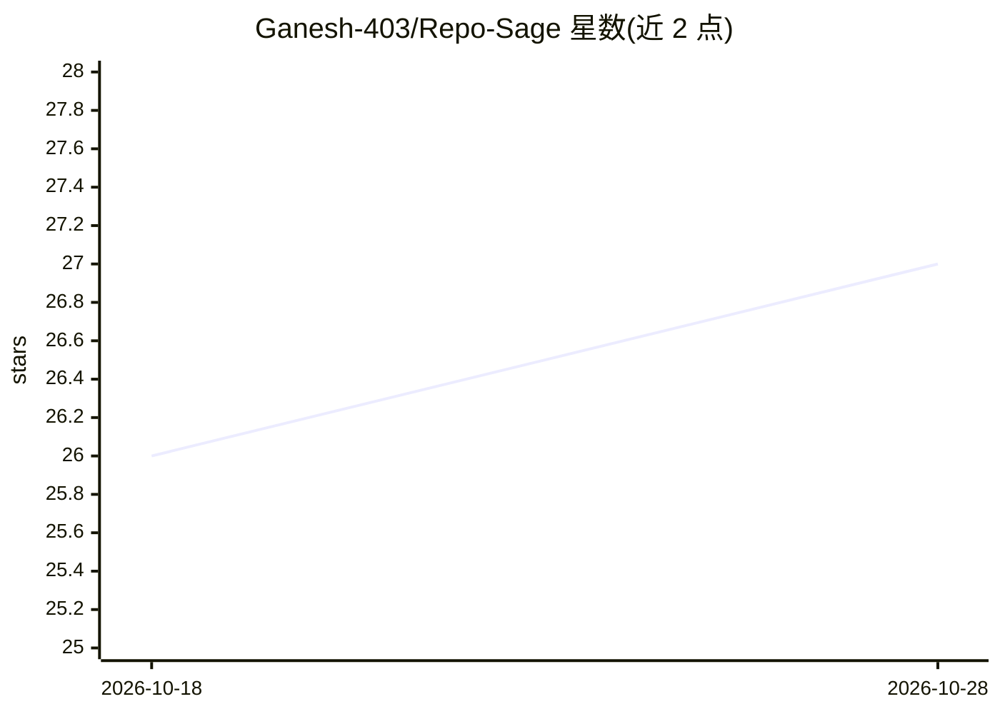

# Ganesh-403/Repo-Sage

⭐ 27 · Python · 推送 2026-07-13 · [GitHub](https://github.com/Ganesh-403/Repo-Sage) · 个人维护

**面向开发者的本地 Agentic GraphRAG 代码库问答系统**

面向开发者与工程团队的代码库智能问答系统：输入 GitHub URL 或本地目录，以自然语言查询代码，返回带文件路径与行号引用的回答。机制上结合 AST 结构化分块、NetworkX 函数调用知识图谱（GraphRAG）、LangGraph 驱动的 Agent 模式（semantic_search/read_file 工具迭代）与 BM25+ChromaDB 并行混合检索（RRF 融合）。全程本地运行，推理依赖本机 Ollama（默认 qwen3:4b / qwen2.5-coder:7b，嵌入用 nomic-embed-text）。后端 FastAPI，前端 React+Vite，支持 Docker Compose 部署；需用户自行安装 Ollama 与拉取模型。

## 筛选速览

| 维度 | 判定 | 备注 |
|---|---|---|
| AI 角色 | `ai-native` | 本体是模型或模型工具 |
| 许可风险 | `permissive` | — |
| 部署形态 | `self-host` | docker 或自建部署 |
| 模型依赖 | local-ok | 支持本地模型 |
| 硬件要求 | — | 无带数字的原话,不猜 |
| 安装摩擦 | `low` | 无编译、无系统依赖或容器化 |
| 成熟度 | — | 结构信号不足 |

## 能力要点

- AST 分块 + NetworkX 函数调用图谱的 GraphRAG 检索
- LangGraph Agent 模式：semantic_search 与 read_file 工具迭代调查
- BM25 与 ChromaDB 并行检索经 RRF 融合，检索时间低于 1s
- 100% 本地运行（Ollama），回答带 filename:line_number 引用徽章

## 适用场景

- 对私有代码库做自然语言问答而不上传代码
- 理解函数间依赖关系与调用链以定位实现
- 在代码库中快速检索并核实到具体文件与行号

## 场景标签

`RAG` · 领域:知识与检索

## 证据(README 行号)

> L3: RepoSage is a 100% offline, Agentic GraphRAG system designed for developers and engineering teams. By supplying a lo
> L21: RepoSage operates entirely locally. It utilizes Ollama running reasoning models (such as `qwen3:4b` or `qwen2.5-cod

## 星数曲线

2026-10-18 26 → 2026-10-28 27（+1）

---
*卡片 v1 · prompt 1.4 · 生成 2026-10-26 · 置信度 high · 依据 README sha `629ee141f807` · [字段定义](../../DATASET.md)*
