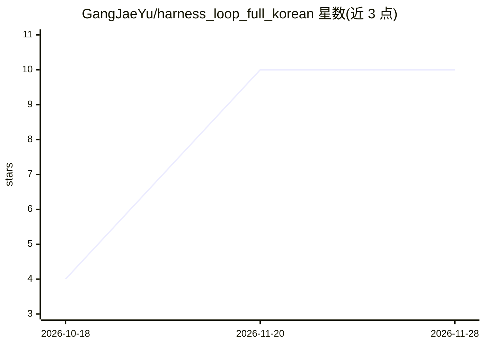

# GangJaeYu/harness_loop_full_korean

⭐ 10 · MIT · 推送 2026-11-01 · [GitHub](https://github.com/GangJaeYu/harness_loop_full_korean) · 个人维护 · 中文 README

**面向 Claude Code 与 Codex 的韩语智能体开发技能插件**

一组韩语智能体技能插件，将开发流程组织为 IDEA → PRD → TRD → 架构 → 计划 → 验证 harness → 自主 Loop 的阶段，提供 13 个可按名称调用的技能（如 prd-generator、bug-fix、refactor-plan）。完成判定按 lint → unit → e2e → task_validation 顺序执行，最终判定由未参与实现的独立会话运行；Loop 启动前由人协商目的、权限与预算，Loop 期间不提问，失败 3 次内切换策略，否则如实报告未完成。宿主为 Claude Code 或 Codex CLI，需 git；使用 Loop 完成任务消耗时间与 token 多于单次提示。

## 筛选速览

| 维度 | 判定 | 备注 |
|---|---|---|
| AI 角色 | `ai-ecosystem` | LLM/agent 周边工具 |
| 许可风险 | `permissive` | MIT |
| 部署形态 | `None` |  |
| 模型依赖 | — | README 未给出锁定关系 |
| 硬件要求 | — | 无带数字的原话,不猜 |
| 安装摩擦 | `low` | 无编译、无系统依赖或容器化 |
| 成熟度 | — | 结构信号不足 |

## 能力要点

- 13 个技能覆盖从需求文档到实现、验证、后续维护的流程
- lint→unit→e2e→task_validation 四道验证门，独立会话执行最终判定
- 支持并行 worker，配合 Orca 以 worktree 方式分派
- 1.x（9,699 行技能指令）在 2.0 重写为约 1,603 行

## 适用场景

- 从一句想法出发让智能体完成文档、实现与验证的完整开发流程
- 为缺少文档的现有代码生成基线文档后再纳入该流程
- 在 Claude Code 与 Codex 中按统一规则执行功能添加、bug 修复与重构

## 场景标签

`编码 Agent` · 领域:编码与开发

## 证据(README 行号)

> L5: *Korean agent skills for Claude Code & Codex — idea → PRD → architecture → plan → verification harness → autonomous 
> L42: |실행 구조|프로젝트마다 구동·감시 스크립트 생성|Claude Code·Codex·Orca 기능을 그대로 사용|
> L66: **필요한 것:** git, Claude Code 또는 Codex CLI. 나머지 도구(Docker, 브라우저 테스트, WSL, Orca 등)는 프로젝트에 필요할 때 에이전트가 확인하고, 없으면 Loop 전

## 星数曲线

2026-10-18 4 → 2026-11-28 10（+6）

---
*卡片 v1 · prompt 1.4 · 生成 2026-11-20 · 置信度 high · 依据 README sha `250543873428` · [字段定义](../../DATASET.md)*
