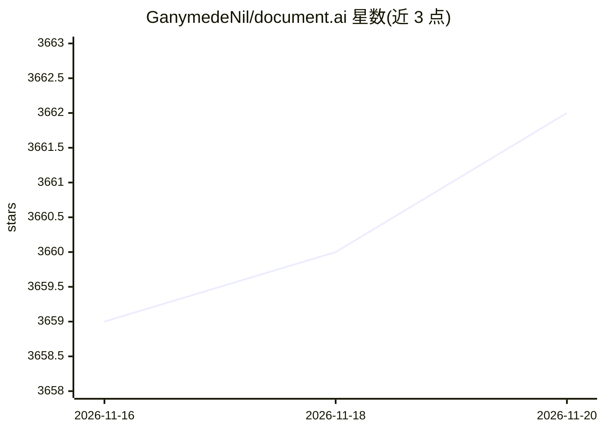

# GanymedeNil/document.ai

⭐ 3,662 · Python · AGPL-3.0 · 推送 2026-11-16 · [GitHub](https://github.com/GanymedeNil/document.ai) · 个人维护 · 中文 README

**可溯源、带版本与时效判断的企业知识库问答系统**

面向企业知识库的问答系统（EAER）：回答附带证据定位——出自哪份文档、哪个版本、哪一处，以及依据在目标时间是否有效。提供三种执行模式（Fast/Deep/Verified）、代码执行的验证层与权限检查、三类时间查询、文档生命周期管理（上传-审核-归档）、提示注入防护与 OpenTelemetry 观测。技术栈为 FastAPI + PostgreSQL + OpenSearch + Next.js，本地参考实现含 Qwen3 Embedding/Reranker 模型服务。局限：集群版尚未实现，解析与时间抽取未在真实客户文档上人工核对，语义检查偏宽。AGPL-3.0 许可。

## 筛选速览

| 维度 | 判定 | 备注 |
|---|---|---|
| AI 角色 | `ai-native` | 本体是模型或模型工具 |
| 许可风险 | `viral` | AGPL-3.0 |
| 部署形态 | `self-host` | docker 或自建部署 |
| 模型依赖 | — | README 未给出锁定关系 |
| 硬件要求 | — | 无带数字的原话,不猜 |
| 安装摩擦 | `low` | 无编译、无系统依赖或容器化 |
| 成熟度 | — | 结构信号不足 |

## 能力要点

- 证据溯源到文档版本与位置，含三类时间查询（当前生效/某天生效/回溯）
- 验证层由代码做确定性检查（引用、权限、数值日期、有效期），不过则拒答
- 权限由代码执行，无权与不存在一律返回 404，授权范围不进模型上下文
- 支持 Word/PDF/扫描件/PPTX/XLSX/图片解析（Docling 含 OCR），表格拆为单元格证据

## 适用场景

- 企业制度/合规文档问答，需注明依据版本与有效期
- 回溯查询某历史时点实际生效的规定
- 带权限隔离与审计追溯的多租户知识库

## 场景标签

`文档问答` `RAG` · 领域:知识与检索

## 证据(README 行号)

> L3: 可溯源、带时效判断的企业知识库问答。
> L5: 用户不仅得到答案，还能看到答案来自哪份文档的哪个版本、哪一处，以及这条依据在问题关心的那一天是否有效。制度会修订、会作废、会被补充通知覆盖，“查到一段相似的话”不等于“答对了”；EAER 把版本、有效期、权限和验证当作问答本身的一部
> L11: - **三种执行模式。** Fast 一次检索直接作答；Deep 按计划模板（比较、多跳、因果）分步检索；Verified 在作答后做语义检查与定向补检索。Router 按问题选入口，证据不足时逐级升级，预算用尽仍无法确认就拒答。

## 星数曲线

2026-11-16 3,659 → 2026-11-20 3,662（+3）

---
*卡片 v1 · prompt 1.4 · 生成 2026-11-17 · 置信度 mid · 依据 README sha `0780228f7919` · [字段定义](../../DATASET.md)*
