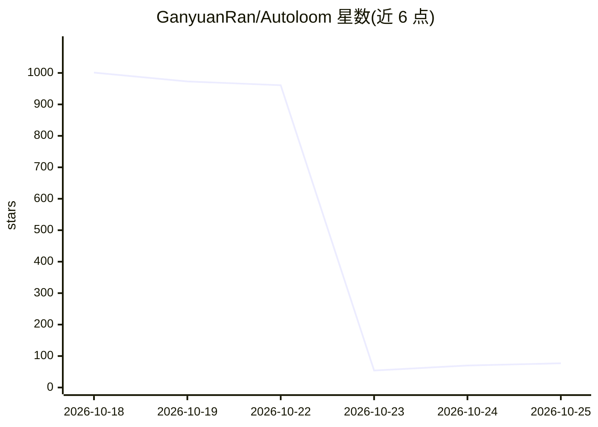

# GanyuanRan/Autoloom

⭐ 77 · JavaScript · NOASSERTION · 推送 2026-10-23 · [GitHub](https://github.com/GanyuanRan/Autoloom) · [官网](autoloom.codes/) · 个人维护 · 中文 README

**带工程治理方法的 AI 编程桌面客户端（Windows x64）**

基于 DeepSeek Harness dsh-v0.1.1-rc.2 构建的 Electron 桌面 AI 编程客户端，集成开源 Aegis 治理方法包：任务开始时审查变更必要性，改动前做结构复杂度与反例检查，执行失败后要求基于观察的因果诊断，交付前对照需求与验证材料复核。支持本地项目与 SSH 连接的 Linux x64 远程项目，内置公共 Parallel/Exa MCP 网络搜索。客户端免费，模型用量按用户所选 provider 计费。当前为 Beta，仅提供 Windows x64 安装包，客户端源码未公开。

## 筛选速览

| 维度 | 判定 | 备注 |
|---|---|---|
| AI 角色 | `ai-native` | 本体是模型或模型工具 |
| 许可风险 | `none` | NOASSERTION |
| 部署形态 | `desktop` | 安装包/桌面程序 |
| 模型依赖 | — | README 未给出锁定关系 |
| 硬件要求 | — | 无带数字的原话,不猜 |
| 安装摩擦 | `low` | 无编译、无系统依赖或容器化 |
| 成熟度 | `idea` | |

## 能力要点

- 将 Aegis 治理方法（变更必要性、复杂度检查、因果诊断、交付复核）嵌入编码执行流程
- 记录项目目标、约束与关键决策，决策变更以 diff 呈现
- 支持本地项目与 SSH 远程 Linux x64 项目，含代码 diff、命令日志、交互终端
- 内置公共 Parallel/Exa MCP 网络搜索，无需单独搜索 API key

## 适用场景

- 在桌面客户端中用自选模型执行 AI 编程任务并获得过程记录
- 对 agent 代码改动做必要性与交付证据审查
- 在 Windows 上通过 SSH 管理 Linux 远程项目开发

## 场景标签

`编码 Agent` · 领域:编码与开发

## 证据(README 行号)

> L20: **AI coding with engineering judgment built into execution.**
> L22: Autoloom brings Aegis’s core governance methods into the coding runtime: question whether a change is needed, chall
> L80: 2. Install and open Autoloom. Add your model provider and API key in settings, then select a default model.

## 星数曲线

2026-10-18 1,001 → 2026-10-25 77（-924）

---
*卡片 v1 · prompt 1.4 · 生成 2026-10-21 · 置信度 high · 依据 README sha `646da8274b43` · [字段定义](../../DATASET.md)*
