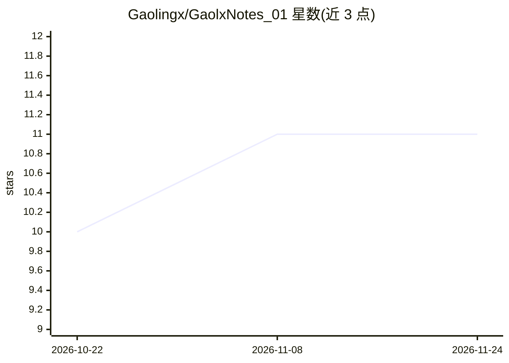

# Gaolingx/GaolxNotes_01

⭐ 11 · HTML · 推送 2026-11-22 · [GitHub](https://github.com/Gaolingx/GaolxNotes_01) · 个人维护

**机器学习/3D/GPGPU 学习笔记仓库**

一个以学习笔记为主的开源仓库，README 中可验证的信息极少，仅标题一行；仓库主题标签显示内容涉及 C#、GPGPU、机器学习、Unity 等方向。描述自称是关于机器学习、3D 与 GPGPU 的学习笔记。具体笔记结构、内容深度、安装或运行方式在 README 中均未说明，无法进一步核实。

## 筛选速览

| 维度 | 判定 | 备注 |
|---|---|---|
| AI 角色 | `ai-knowledge` | 知识聚合/清单类 |
| 许可风险 | `none` | — |
| 部署形态 | `None` |  |
| 模型依赖 | — | README 未给出锁定关系 |
| 硬件要求 | — | 无带数字的原话,不猜 |
| 安装摩擦 | `low` | 无编译、无系统依赖或容器化 |
| 成熟度 | — | 结构信号不足 |

## 能力要点

- 主题标签覆盖 csharp、gpgpu、machine-learning、unity
- 内容形式为学习笔记（study-notes）

## 适用场景

- 查找机器学习与 GPGPU 相关的个人学习笔记参考
- 结合 Unity 与 C# 学习 3D/GPGPU 相关知识

## 场景标签

 · 领域:教育培训/学习资料

## 证据(README 行号)

> L1: # GaolxNotes_01

## 星数曲线

2026-10-22 10 → 2026-11-24 11（+1）

---
*卡片 v1 · prompt 1.4 · 生成 2026-11-19 · 置信度 low · 依据 README sha `de3a9b3dbcf5` · [字段定义](../../DATASET.md)*
