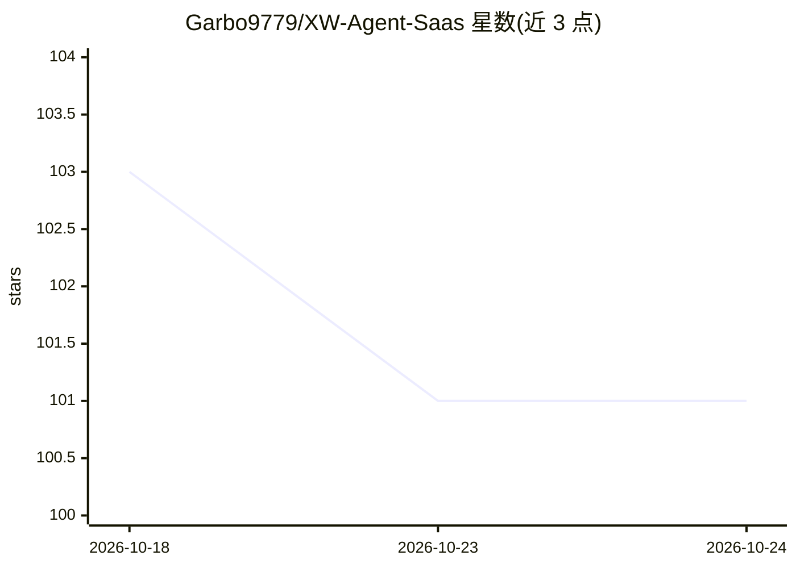

# Garbo9779/XW-Agent-Saas

⭐ 101 · HTML · 推送 2026-09-11 · [GitHub](https://github.com/Garbo9779/XW-Agent-Saas) · 个人维护 · 中文 README

**AI 持续运营企业业务的"Business Runtime"概念实验与静态 Demo**

CrewOS+Saas 是关于企业 Agent 产品形态的公开实验仓库，探索 AI 能否持续运营一项长期、复杂、变化的真实业务，首个实验场景为财税业务。当前 main 分支仅是部署在 GitHub Pages 上的静态交互概念 Demo（HTML/CSS/JS），无后端、无用户认证、无数据库与租户隔离，也不需要任何运行时密钥；README 中的权限管控、审批、审计等均为产品目标或架构设想而非已实现功能。仓库记录产品原型、设计思考与 Roadmap（Phase 0-3，多数未完成）。

## 筛选速览

| 维度 | 判定 | 备注 |
|---|---|---|
| AI 角色 | `ai-ecosystem` | LLM/agent 周边工具 |
| 许可风险 | `none` | — |
| 部署形态 | `None` |  |
| 模型依赖 | — | README 未给出锁定关系 |
| 硬件要求 | — | 无带数字的原话,不猜 |
| 安装摩擦 | `low` | 无编译、无系统依赖或容器化 |
| 成熟度 | `idea` | |

## 能力要点

- 提出 Business Runtime / Business State / AI Crew 概念框架
- 财税作为第一个验证业务场景（票据采集→识别→审批等链路设想）
- 明确声明为 Early-stage/Experimental，并列出未实现组件清单
- 提供 Live Demo（GitHub Pages 静态页面）

## 适用场景

- 研究企业 Agent 产品形态与持续运行业务的设计思路
- 参考 Business Runtime 的概念架构与认证边界建议
- 跟进财税 AI 业务实验的 Roadmap 进展

## 场景标签

 · 领域:企业 AI / Agent 运行时

## 证据(README 行号)

> L14: **CrewOS is a Business Runtime for AI-operated businesses.**
> L433: **Early-stage / Experimental**

## 星数曲线

2026-10-18 103 → 2026-10-24 101（-2）

---
*卡片 v1 · prompt 1.4 · 生成 2026-10-23 · 置信度 mid · 依据 README sha `3ac40c25b81c` · [字段定义](../../DATASET.md)*
