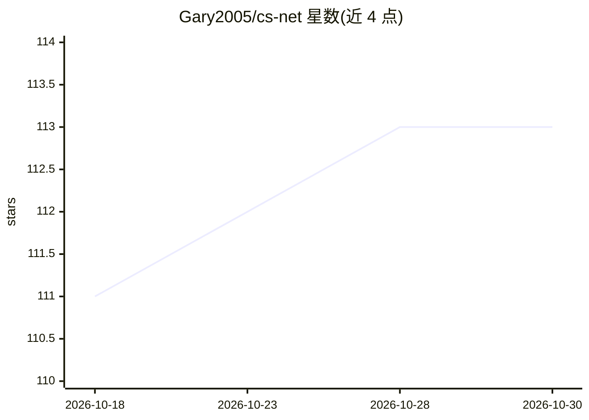

# Gary2005/cs-net

⭐ 113 · JavaScript · MIT · 推送 2026-09-10 · [GitHub](https://github.com/Gary2005/cs-net) · [官网](https://gary2005.github.io/cs-net/) · 个人维护 · 中文 README

**基于 Transformer 的 CS2 比赛回放分析与路径预测框架**

面向 Counter-Strike 2 回放（.dem）的深度学习工具栈：预训练 Transformer（138.7M 参数）以 16 tick 游戏状态窗口自回归预测每个玩家的未来移动路径；空间任务族从单 tick 状态预测胜率、回合末存活与未来击杀概率；并附带 Flask 3D 可视化器，可上传回放与 checkpoint 对比 AI 预测路径与真实轨迹。提供 checkpoint 下载、Python 库/CLI 推理接口与两套训练脚本，推理支持 CPU/MPS/CUDA。

## 筛选速览

| 维度 | 判定 | 备注 |
|---|---|---|
| AI 角色 | `ai-native` | 本体是模型或模型工具 |
| 许可风险 | `permissive` | MIT |
| 部署形态 | `desktop` | 安装包/桌面程序 |
| 模型依赖 | — | README 未给出锁定关系 |
| 硬件要求 | — | 无带数字的原话,不猜 |
| 安装摩擦 | `medium` | 含编译或系统依赖之一 |
| 成熟度 | — | 结构信号不足 |

## 能力要点

- 自回归预测每名玩家未来移动路径（move/angle 离散 token）
- 单 tick 输入预测胜率/存活/未来击杀概率的空间任务族
- Flask 3D 可视化器：回放播放、AI 路径 vs 真实轨迹对比、实时概率曲线
- .dem → round JSON → WebDataset 分片的完整数据与训练流水线

## 适用场景

- 分析 CS2 比赛回放，预测玩家走位与回合走势
- 可视化对比模型预测路径与真实移动轨迹
- 基于回放数据训练或微调自己的预测模型

## 场景标签

`模型训练` · 领域:训练与推理

## 证据(README 行号)

> L24: |**Path prediction model**|Pre-trained Transformer that takes a 16-tick window of the full game state (10 players +
> L25: |**Spatial-only models**|The minimal downstream task family: from a **single tick** of the full game state, predict

## 星数曲线

2026-10-18 111 → 2026-10-30 113（+2）

---
*卡片 v1 · prompt 1.4 · 生成 2026-10-23 · 置信度 high · 依据 README sha `2d106a8c74a8` · [字段定义](../../DATASET.md)*
