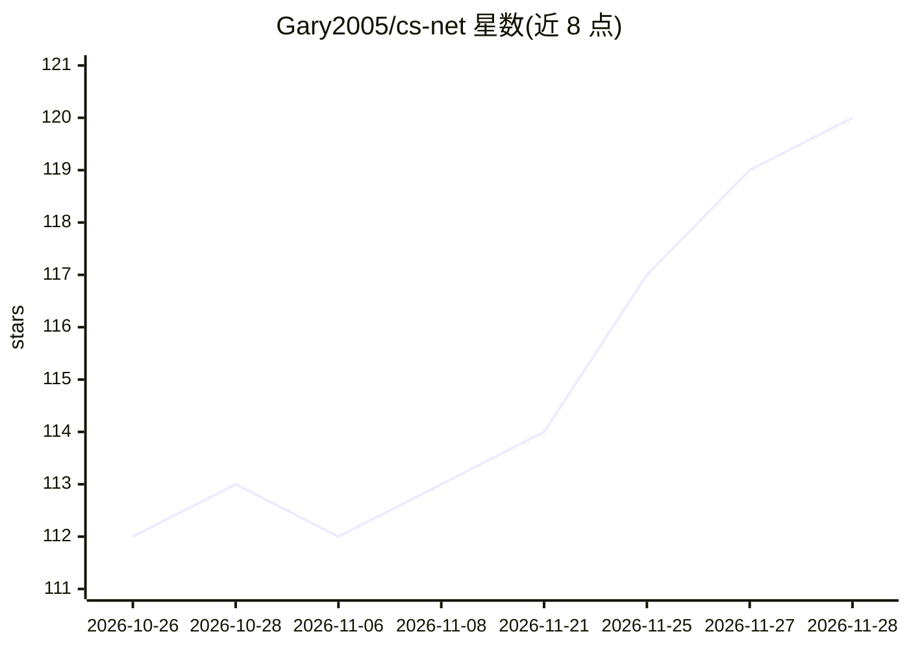

# Gary2005/cs-net

⭐ 120 · JavaScript · MIT · 推送 2026-11-25 · [GitHub](https://github.com/Gary2005/cs-net) · 个人维护 · 中文 README

**本地运行的 CS2 比赛录像 AI 分析与 3D 回放工具**

面向 CS2 玩家的本地分析工具：读取 .dem 录像，提取为 .csz 格式（逐 tick 采样、zstd 压缩、烟雾/火焰体素经 Go 侧通道解码），提供 Web 应用管理 demo 库、扫描导入、3D 回放（玩家、投掷物、烟雾体积、击杀信息流、小地图），并聚合选手数据。AI 部分包含回合胜率预测面板、选手五项数据头与对枪胜负弧线预测；模型权重（共 665 MB）托管在 Hugging Face，支持 hf-mirror 镜像自动切换。代码 MIT 许可，但游戏内容资产归 Valve。

## 筛选速览

| 维度 | 判定 | 备注 |
|---|---|---|
| AI 角色 | `ai-native` | 本体是模型或模型工具 |
| 许可风险 | `permissive` | MIT |
| 部署形态 | `desktop` | 安装包/桌面程序 |
| 模型依赖 | — | README 未给出锁定关系 |
| 硬件要求 | — | 无带数字的原话,不猜 |
| 安装摩擦 | `low` | 无编译、无系统依赖或容器化 |
| 成熟度 | — | 结构信号不足 |

## 能力要点

- .dem → .csz 精确编解码（逐 tick ≈64Hz 采样，bit 级一致）
- AI 面板输出回合胜率、选手五项数据与对枪胜负预测
- 3D 回放含烟雾体积、火焰单元与可见性显示
- 提供免 Python/conda 的 Windows x64 zip 包，可离线运行

## 适用场景

- 导入自己的 CS2 比赛录像做 3D 复盘
- 查看选手瞄准/影响数据与 AI 数据面板
- 离线环境下本地分析比赛录像

## 场景标签

 · 领域:游戏/数据分析

## 证据(README 行号)

> L26: cs-net v5 is an AI analysis tool that runs locally, with 3D replay built in.
> L95: 5. **Turn on AI** — bottom of the replay page: **AI 预测面板** (round win chance,
> L96:  per-player five heads) and **AI 对枪** (who wins the next duel, as an arc).

## 星数曲线

2026-10-26 112 → 2026-11-28 120（+8）

---
*卡片 v1 · prompt 1.4 · 生成 2026-11-28 · 置信度 high · 依据 README sha `3d26d9e9555b` · [字段定义](../../DATASET.md)*
