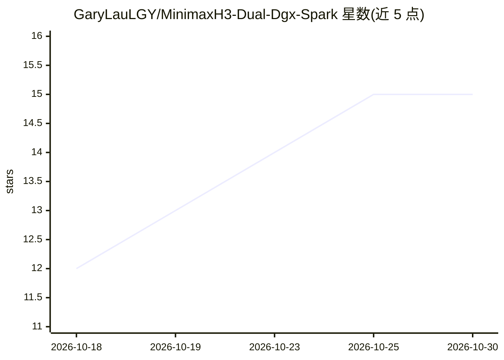

# GaryLauLGY/MinimaxH3-Dual-Dgx-Spark

⭐ 15 · Python · MIT · 推送 2026-10-01 · [GitHub](https://github.com/GaryLauLGY/MinimaxH3-Dual-Dgx-Spark) · 个人维护 · 中文 README

**双 DGX Spark 分布式推理 H3 视频的实验运行器**

通过 RoCE 直连两台 NVIDIA DGX Spark，对 MiniMax H3 视频生成模型做双机推理的实验项目。基于现有 ComfyUI H3 实现与 buqi-minimax-h3-multigpu，提供隔离运行器、双机启动脚本、环境预检与数值验证。实测口径下热生成从 104.09 秒降至 46.41 秒（2.24×），12 个 MP4 的 SHA256 相同。目前是命令行实验后端，不是可直接拖入 ComfyUI 的插件；不含模型权重，不安装驱动或配置网络。

## 筛选速览

| 维度 | 判定 | 备注 |
|---|---|---|
| AI 角色 | `ai-ecosystem` | LLM/agent 周边工具 |
| 许可风险 | `permissive` | MIT |
| 部署形态 | `None` |  |
| 模型依赖 | — | README 未给出锁定关系 |
| 硬件要求 | — | 无带数字的原话,不猜 |
| 安装摩擦 | `low` | 无编译、无系统依赖或容器化 |
| 成熟度 | `idea` | |

## 能力要点

- 双机序列并行、QKV 分头与通信分块共同计算，实测热生成 2.24× 加速
- 双机与单机输出对照：12 个 MP4 的 SHA256 完全相同，VAE 像素 exact=true
- validate 预检主机、ComfyUI 提交、模型文件与 GPU 进程状态
- S02 作者图双机适配器，可选 INT8 路由实测省时中位 10.75%

## 适用场景

- 拥有两台 DGX Spark 的用户加速 H3 视频生成推理
- 以可复现口径记录单机/双机性能与输出一致性
- 研究多机序列并行与并行 VAE 的工程实现

## 场景标签

`视频生成` `推理引擎` · 领域:内容生成

## 证据(README 行号)

> L5: 两台 NVIDIA DGX Spark，通过 RoCE 直连共同完成一条 H3 视频的推理。基于现有 ComfyUI H3 实现，提供隔离运行器、双机启动脚本、数值验证和可核算的测试记录。
> L7: **固定测试中，热运行从 104.09 秒降到 46.41 秒：完整生成 2.24×，20 步采样 2.40×。**
> L44: 运行器在独立 Python 进程里调用现有 ComfyUI 节点与模型代码。它目前是命令行实验后端，不是可直接拖入任意 ComfyUI 工作流的插件。

## 星数曲线

2026-10-18 12 → 2026-10-30 15（+3）

---
*卡片 v1 · prompt 1.4 · 生成 2026-10-30 · 置信度 high · 依据 README sha `904f58d6dcb1` · [字段定义](../../DATASET.md)*
