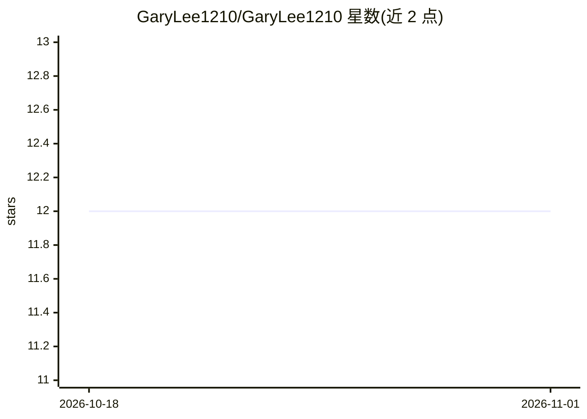

# GaryLee1210/GaryLee1210

⭐ 12 · 推送 2026-09-22 · [GitHub](https://github.com/GaryLee1210/GaryLee1210) · 个人维护 · 中文 README

**个人研究者主页：AI/具身智能/机器人导航知识图谱与论文清单**

GaryLee1210 的个人 GitHub 主页 README，作者为东北大学机器人学硕士在读、Beta Infinity 实习生，研究方向为图像目标导航。内容包含个人项目（无人机导航系统、GeoSRNav 论文项目）、研究笔记（镜像自刘铁德笔记并每日同步）以及按 6 大主题组织的 AI→具身智能→机器人导航知识图谱：机器学习/深度学习、强化学习、基础模型、机器人操作（含 VLA）、机器人导航（细分经典几何/端到端/模块化/语言驱动/基础模型 5 条线索）与世界模型及 3D 感知，每类附代表性算法与官方代码仓库链接，并提供中英双语 Image-Goal Navigation 论文清单。

## 筛选速览

| 维度 | 判定 | 备注 |
|---|---|---|
| AI 角色 | `ai-knowledge` | 知识聚合/清单类 |
| 许可风险 | `none` | — |
| 部署形态 | `None` |  |
| 模型依赖 | — | README 未给出锁定关系 |
| 硬件要求 | — | 无带数字的原话,不猜 |
| 安装摩擦 | `low` | 无编译、无系统依赖或容器化 |
| 成熟度 | — | 结构信号不足 |

## 能力要点

- 按 6 大主题组织的 AI→具身智能→导航知识图谱，附官方代码链接
- 导航部分细分 5 条线索，含 VLN、ImageNav、导航基础模型
- 维护中英双语 Image-Goal Navigation 论文清单
- 附个人项目（FAST-LIO2+EGO-Planner 无人机导航系统）与研究计划

## 适用场景

- 查找具身智能与机器人导航方向的代表性算法与代码
- 按主题脉络了解 ImageNav/VLN/世界模型领域的论文与工具
- 跟踪作者的 GeoSRNav 研究项目与代码发布进展

## 场景标签

`精选清单` · 领域:学习与行业

## 证据(README 行号)

> L33: My reading map of **AI → Embodied AI → Robot Navigation**, with representative algorithms and official implementati
> L130: ## 🧭 5. Robot Navigation ⭐

## 星数曲线

2026-10-18 12 → 2026-11-01 12（+0）

---
*卡片 v1 · prompt 1.4 · 生成 2026-11-01 · 置信度 high · 依据 README sha `afae696bbdad` · [字段定义](../../DATASET.md)*
