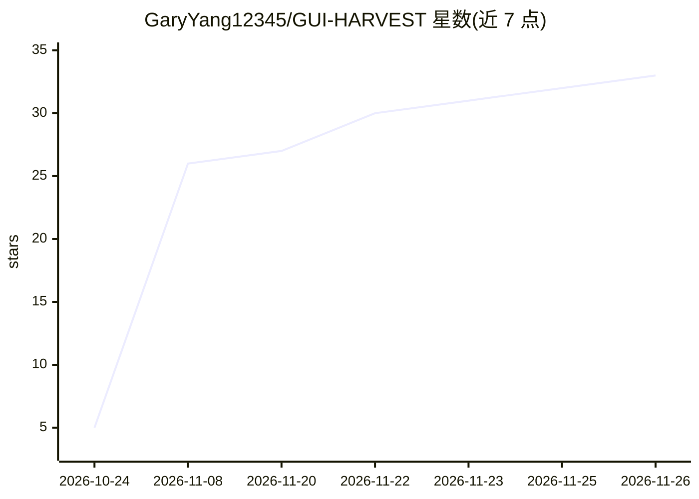

# GaryYang12345/GUI-HARVEST

⭐ 33 · Python · Apache-2.0 · 推送 2026-09-29 · [GitHub](https://github.com/GaryYang12345/GUI-HARVEST) · 个人维护

**冻结模型下自动改进 GUI agent 执行框架（harness）的优化工具**

面向计算机操作类 GUI agent 的研究工具：保持模型权重、基准任务、评测器与环境全部冻结，仅对包裹模型的可执行 harness（提示词、上下文构造、记忆、动作接口、控制流、验证与恢复等）做自动优化。机制上通过重复 rollout 收集证据，Evidence Analyst 与 Cross-task Clusterer 归纳失败模式，Harness Engineer 编辑候选源码，Validator 按分数与行为门槛决定晋升或回滚，Test 集保持密封至优化结束。不捆绑基准与 harness，需自行安装 OSWorld 与种子 harness（如 Agent S3），以 Python 包加 CLI 交付。

## 筛选速览

| 维度 | 判定 | 备注 |
|---|---|---|
| AI 角色 | `ai-ecosystem` | LLM/agent 周边工具 |
| 许可风险 | `permissive` | Apache-2.0 |
| 部署形态 | `library` | 以包/库形式分发 |
| 模型依赖 | — | README 未给出锁定关系 |
| 硬件要求 | — | 无带数字的原话,不猜 |
| 安装摩擦 | `low` | 无编译、无系统依赖或容器化 |
| 成熟度 | — | 结构信号不足 |

## 能力要点

- 优化对象限定为 harness，模型权重与评测环境冻结
- Search/Validation/Test 分层任务集，Test 密封至优化结束
- 晋升需同时满足 ΔSearch≥0、ΔValidation≥0 及行为预测与 L0/L1 检查
- 支持本地编码 agent、外部命令或 API 后端三种 Engineer 模式

## 适用场景

- 在不改动模型权重的前提下迭代 GUI agent 的 harness 实现
- 对 OSWorld 类计算机操作基准做受控的 harness 优化实验
- 以密封 Test 集防止优化过程中的基准过拟合

## 场景标签

`GUI 自动化` `模型评测` · 领域:效率与自动化

## 证据(README 行号)

> L3: GUI-HARVEST automatically improves the executable harness around a frozen
> L8: The optimized object is the **harness**: prompts, context construction, memory,
> L10: Model weights, benchmark tasks, evaluators, environments, and resource limits

## 星数曲线

2026-10-24 5 → 2026-11-26 33（+28）

---
*卡片 v1 · prompt 1.4 · 生成 2026-11-18 · 置信度 high · 依据 README sha `4b80f94f068a` · [字段定义](../../DATASET.md)*
