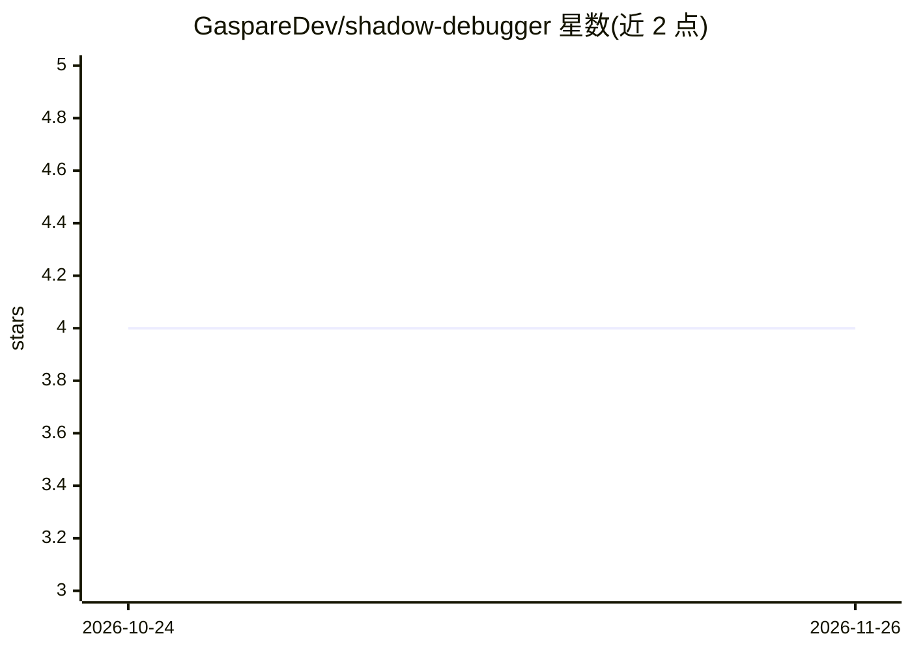

# GaspareDev/shadow-debugger

⭐ 4 · Python · MIT · 推送 2026-10-19 · [GitHub](https://github.com/GaspareDev/shadow-debugger) · 个人维护

**Python 应用的后台异常诊断库：捕获错误并生成 LLM 分析报告**

嵌入 Python 应用（FastAPI/Flask/Django）的错误诊断工具：异常或 HTTP 500 发生时，从后台线程捕获栈帧、脱敏本地变量与请求数据后发送给 LLM，不阻塞应用正常响应，几秒后在 ./shadow_reports/ 生成 Markdown 或 JSON 事后报告，含根因分析、修复补丁与预防建议。核心包仅用标准库，支持本地 Ollama 免 API key 运行，也支持 Gemini/OpenAI/Anthropic/Mistral 及 OpenAI 兼容端点；提供自定义 Provider 注册接口、CLI 报告浏览命令，生成的代码补丁仅做 ast.parse 检查不执行。

## 筛选速览

| 维度 | 判定 | 备注 |
|---|---|---|
| AI 角色 | `ai-native` | 本体是模型或模型工具 |
| 许可风险 | `permissive` | MIT |
| 部署形态 | `library` | 以包/库形式分发 |
| 模型依赖 | local-ok | 支持本地模型 |
| 硬件要求 | — | 无带数字的原话,不猜 |
| 安装摩擦 | `low` | 无编译、无系统依赖或容器化 |
| 成熟度 | — | 结构信号不足 |

## 能力要点

- 后台线程诊断，不阻塞应用正常响应
- 内置密钥脱敏：变量名、JWT/API key/Bearer/PEM 等模式清洗
- 支持本地 Ollama（零外部依赖）与多家云 provider，可注册自定义 Provider
- Markdown/JSON 报告输出与 CLI list/show 浏览

## 适用场景

- 给 FastAPI/Flask/Django 应用接入自动化的异常事后分析
- 离线环境下用本地 Ollama 分析错误且不外发数据
- 以 JSON 格式收集错误诊断供后续机器处理

## 场景标签

 · 领域:开发者工具/错误诊断与可观测性

## 证据(README 行号)

> L6: Background error diagnosis for Python apps and web APIs.
> L8: When an exception or HTTP 500 happens, `shadow-debugger` captures the stack frame from your code, strips secrets fro

## 星数曲线

2026-10-24 4 → 2026-11-26 4（+0）

---
*卡片 v1 · prompt 1.4 · 生成 2026-11-21 · 置信度 high · 依据 README sha `ecd8eb03d1e4` · [字段定义](../../DATASET.md)*
