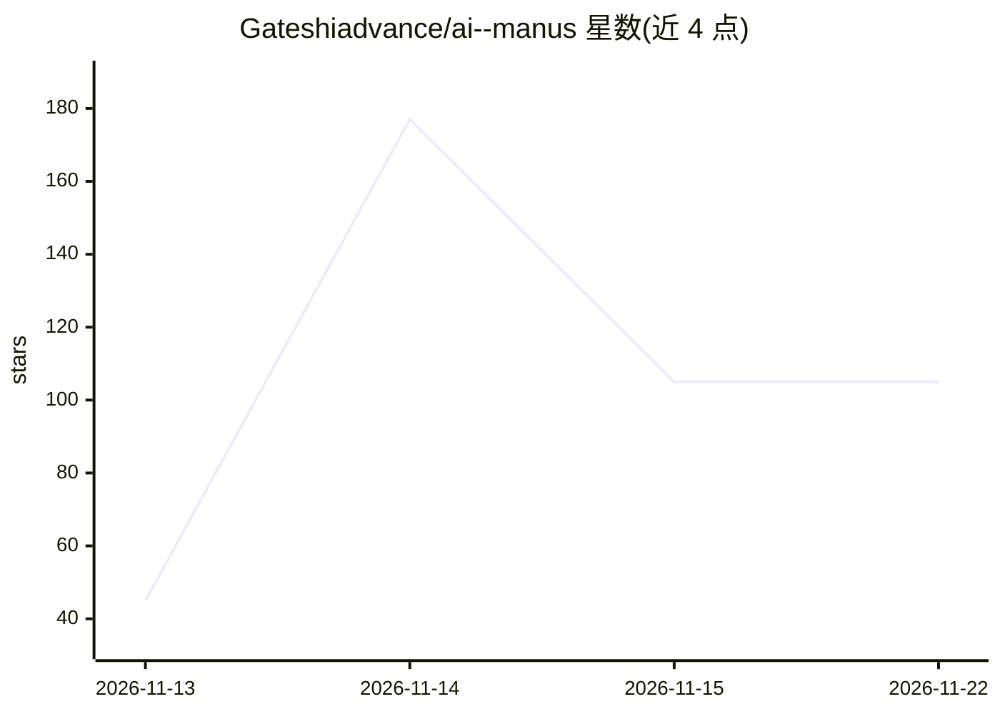

# Gateshiadvance/ai--manus

⭐ 105 · Apache-2.0 · 推送 2026-11-15 · [GitHub](https://github.com/Gateshiadvance/ai--manus) · 个人维护

**面向个人日常任务的自主 AI Agent，可运行代码并控制浏览器**

README 宣称为自主 AI Agent 系统，可在沙箱环境中运行工具与操作：自行编写并执行脚本、控制浏览器完成页面导航、表单填写与信息收集，支持多步任务与跨会话的流程记忆。定位为家庭、学习与轻量办公场景下的个人助手，非企业平台。README 描述了最低配置（双核 CPU、4GB 内存）与上手步骤，但未提供任何安装命令、代码仓库结构或技术实现细节，仅含下载入口与 promo 代码。

## 筛选速览

| 维度 | 判定 | 备注 |
|---|---|---|
| AI 角色 | `ai-native` | 本体是模型或模型工具 |
| 许可风险 | `permissive` | Apache-2.0 |
| 部署形态 | `None` |  |
| 模型依赖 | — | README 未给出锁定关系 |
| 硬件要求 | — | 无带数字的原话,不猜 |
| 安装摩擦 | `low` | 无编译、无系统依赖或容器化 |
| 成熟度 | — | 结构信号不足 |

## 能力要点

- 自主编写并执行代码完成任务
- 浏览器控制：导航、填表、收集信息
- 代码执行与浏览器操作可在同一任务流中衔接
- 面向小规模场景（学习/家庭/轻办公）的常驻个人助手

## 适用场景

- 让 Agent 代为完成重复的网页操作与脚本执行
- 学生整理研究资料、跑快速计算
- 远程办公时从多个页面收集数据做小结

## 场景标签

`AI 助手` `浏览器自动化` · 领域:效率与自动化

## 证据(README 行号)

> L10: - **Autonomous Code Execution:** Manus AI agent runs code on its own to complete tasks, so you can focus on decisio
> L18: Manus is an autonomous AI agent designed to run code and control a browser on your behalf. Instead of acting like a

## 星数曲线

2026-11-13 45 → 2026-11-22 105（+60）

---
*卡片 v1 · prompt 1.4 · 生成 2026-11-17 · 置信度 low · 依据 README sha `0f78ee3a5dd2` · [字段定义](../../DATASET.md)*
