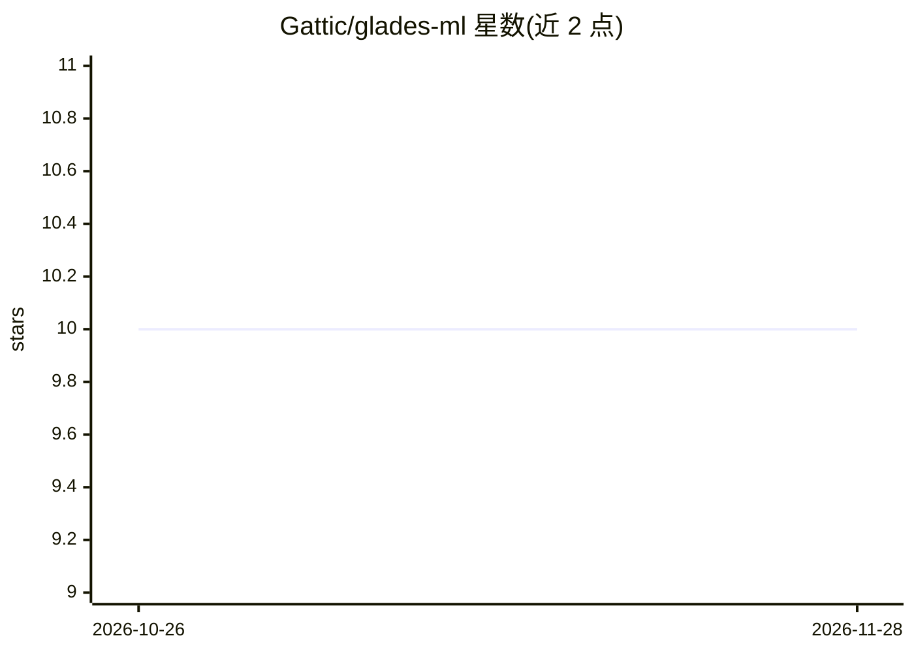

# Gattic/glades-ml

⭐ 10 · C++ · MIT · 推送 2026-11-27 · [GitHub](https://github.com/Gattic/glades-ml) · [官网](https://glades-ml.com) · 个人维护

**C++ 深度前馈神经网络创建与管理库**

glades 是一个开源 C++ 机器学习库，专注于深度前馈神经网络（Deep Feed Forward Networks）的创建与管理，使用 shmea 数据库与网络库以简化使用。代码基于 C++98 编写，README 未给出安装步骤、构建说明或使用示例，仅提供官网、GitHub 仓库链接与 Discord 频道入口，版本号为 v0.59。

## 筛选速览

| 维度 | 判定 | 备注 |
|---|---|---|
| AI 角色 | `ai-native` | 本体是模型或模型工具 |
| 许可风险 | `permissive` | MIT |
| 部署形态 | `None` |  |
| 模型依赖 | — | README 未给出锁定关系 |
| 硬件要求 | — | 无带数字的原话,不猜 |
| 安装摩擦 | `low` | 无编译、无系统依赖或容器化 |
| 成熟度 | — | 结构信号不足 |

## 能力要点

- 专注深度前馈神经网络的 C++ 库
- 使用 shmea 数据库与网络库
- 基于 C++98 编写
- 提供官网与 Discord 渠道

## 适用场景

- 在 C++ 项目中构建深度前馈神经网络
- 在嵌入式设备上运行前馈网络推理

## 场景标签

`模型训练` `推理引擎` · 领域:训练与推理

## 证据(README 行号)

> L21: This is an open source machine learning library specializing in Deep Feed Forward Networks for C++. This uses the s
> L22: This is coded in C++98.

## 星数曲线

2026-10-26 10 → 2026-11-28 10（+0）

---
*卡片 v1 · prompt 1.4 · 生成 2026-11-20 · 置信度 mid · 依据 README sha `efc195ceec15` · [字段定义](../../DATASET.md)*
