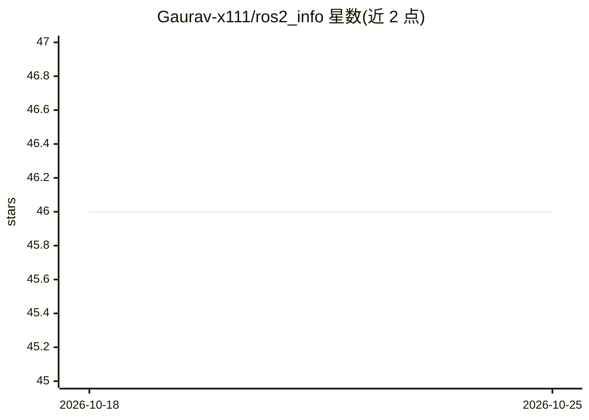

# Gaurav-x111/ros2_info

⭐ 46 · Python · MIT · 推送 2026-10-14 · [GitHub](https://github.com/Gaurav-x111/ros2_info) · 个人维护

**面向 ROS 2 开发者的 Rust 终端 IDE 与实时监控面板**

用 Rust 编写的单二进制 TUI，将 VS Code 式编辑器、PTY 终端、文件浏览器与六个实时仪表盘（Overview/ROS 2/Workspace/Diagnostics/Trends/Fleet）集成在一屏，通过后台 Python collector 采集 ROS 2 节点/话题/服务数据，支持 ROS 2 图谱可视化、沙箱/全局命令模式、跨 Docker 容器聚合、插件 API 与 GitHub 集成。AI 部分为终端内 ai scan/fix/explain/chat 命令（Ollama 后端、diff 门控）。Linux x86_64/aarch64 为主要平台，macOS 未主测，Windows 暂不支持；需 git clone 后 cargo build 从源码构建。

## 筛选速览

| 维度 | 判定 | 备注 |
|---|---|---|
| AI 角色 | `ai-enhanced` | 去掉 AI 部分产品仍成立 |
| 许可风险 | `permissive` | MIT |
| 部署形态 | `library` | 以包/库形式分发 |
| 模型依赖 | local-ok | 支持本地模型 |
| 硬件要求 | — | 无带数字的原话,不猜 |
| 安装摩擦 | `medium` | 含编译或系统依赖之一 |
| 成熟度 | — | 结构信号不足 |

## 能力要点

- 六个实时仪表盘标签页与 ROS 2 发布者→话题→订阅者图谱可视化
- 终端内 ai scan/fix/auto/chat 命令（Ollama 后端，变更经 Preview→Apply 门控）
- 进程内 Rust 插件 API：添加仪表盘标签、终端命令与生命周期钩子
- 单静态二进制，构建目标含 Raspberry Pi 5 / Jetson Orin / SSH 无头场景

## 适用场景

- 在一屏内替代多终端查看 ROS 2 节点、话题与服务状态
- 通过 SSH 在机器人本体上运行 TUI 做无头开发与监控
- 在沙箱命名空间中试运行命令后再作用于真实系统
- 用 ai 命令扫描构建错误并生成经确认的修复补丁

## 场景标签

 · 领域:机器人/开发工具

## 证据(README 行号)

> L48: - **Full-screen VS Code-style TUI** — Explorer, tabbed editor with syntax highlighting, integrated pty-backed termi
> L54: - **AI assistant** — `ai scan`, `ai fix`, `ai explain`, `ai chat` inside the terminal (Ollama backend, diff-gated)

## 星数曲线

2026-10-18 46 → 2026-10-25 46（+0）

---
*卡片 v1 · prompt 1.4 · 生成 2026-10-25 · 置信度 mid · 依据 README sha `78aa1efd643a` · [字段定义](../../DATASET.md)*
