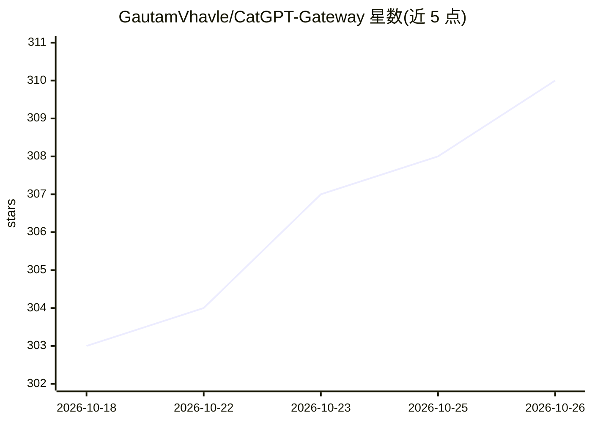

# GautamVhavle/CatGPT-Gateway

⭐ 310 · Python · MIT · 推送 2026-09-14 · [GitHub](https://github.com/GautamVhavle/CatGPT-Gateway) · 个人维护

**把 ChatGPT/Claude 网页账号变成 OpenAI 兼容 API 的网关**

用浏览器自动化方式复用已有的 ChatGPT 或 Claude 网页订阅，在后台运行真实浏览器（含反检测补丁、仿人输入、持久 Cookie），把 claude.ai 与 chatgpt.com 会话封装为 OpenAI 兼容 API 端点，可被 OpenAI SDK、LangChain 及任何 OpenAI 协议客户端调用。支持流式输出、多标签并发、工具调用（经由提示工程实现）、视觉输入、文件附件与 DALL-E 图像生成（仅 ChatGPT）。提供 Docker 与本地两种部署，已知限制包括单请求 5-30 秒、会话需定期重新登录、依赖网页 DOM 选择器。

## 筛选速览

| 维度 | 判定 | 备注 |
|---|---|---|
| AI 角色 | `ai-ecosystem` | LLM/agent 周边工具 |
| 许可风险 | `permissive` | MIT |
| 部署形态 | `None` |  |
| 模型依赖 | — | README 未给出锁定关系 |
| 硬件要求 | — | 无带数字的原话,不猜 |
| 安装摩擦 | `low` | 无编译、无系统依赖或容器化 |
| 成熟度 | — | 结构信号不足 |

## 能力要点

- 浏览器会话封装为 OpenAI 兼容 API（chat completions/流式/多轮）
- 工具调用、视觉输入、文件附件，ChatGPT 侧支持 DALL-E 图像生成
- BrowserPagePool 多标签并发与 /preview 实时多标签监控页
- 提供 Docker 与本地源码两种部署方式

## 适用场景

- 用已有 ChatGPT Plus / Claude 订阅跑本地 OpenAI 协议客户端
- 在 LangChain 应用中调用订阅账号而无官方 API key
- 通过 /preview 页面观察并发浏览器标签的运行状态

## 场景标签

`模型网关` `浏览器自动化` · 领域:Agent 开发

## 证据(README 行号)

> L26: **CatGPT Gateway** turns your existing browser session into a fully functional OpenAI-compatible API server. It run
> L189: Your app (OpenAI SDK / LangChain / curl)

## 星数曲线

2026-10-18 303 → 2026-10-26 310（+7）

---
*卡片 v1 · prompt 1.4 · 生成 2026-10-21 · 置信度 high · 依据 README sha `a30bb6e8a949` · [字段定义](../../DATASET.md)*
