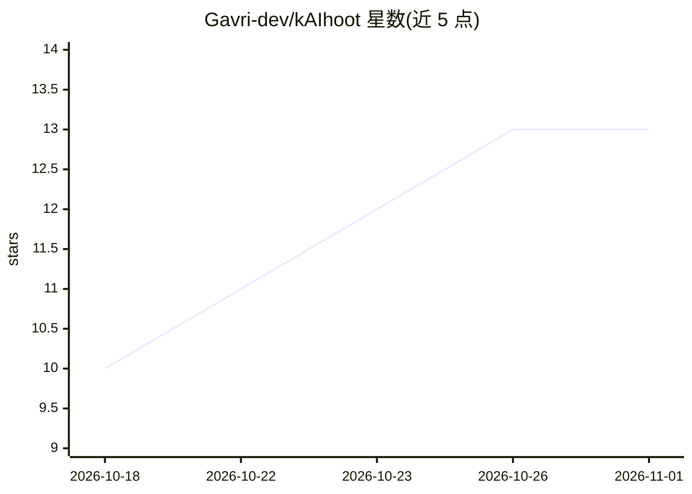

# Gavri-dev/kAIhoot

⭐ 13 · JavaScript · MIT · 推送 2026-04-12 · [GitHub](https://github.com/Gavri-dev/kAIhoot) · [官网](https://github.com/Gavri-dev/kaBot/releases) · 个人维护

**Kahoot 实时答题的 AI Chrome 扩展，自动作答全题型**

Chrome MV3 浏览器扩展：加入 Kahoot 游戏后拦截浏览器与服务器间的 WebSocket 获取题目数据，调用用户自备的 OpenAI API（默认 gpt-5-mini，视觉题用 gpt-4.1）生成答案并通过 DOM 操作与 WS 提交自动作答。覆盖选择题、多选、地图 Pin-It、排序、滑条、开放题与图片题，支持答案延迟与静默模式。无后端、无遥测，API key 仅存本地；需房主开启设备端显示题目方能工作。基于 QuizGPT 扩展开发，声明仅供教育研究用途。

## 筛选速览

| 维度 | 判定 | 备注 |
|---|---|---|
| AI 角色 | `ai-native` | 本体是模型或模型工具 |
| 许可风险 | `permissive` | MIT |
| 部署形态 | `None` |  |
| 模型依赖 | — | README 未给出锁定关系 |
| 硬件要求 | — | 无带数字的原话,不猜 |
| 安装摩擦 | `low` | 无编译、无系统依赖或容器化 |
| 成熟度 | — | 结构信号不足 |

## 能力要点

- 拦截 WebSocket 在题目渲染前获取数据并实时作答
- 覆盖全部题型，含 Pin-It 地图坐标估算与视觉模型兜底
- 自带 API key、无后端无遥测，key 存于 chrome.storage.local
- 提供答案延迟（0-30 秒）与静默模式

## 适用场景

- 在 Kahoot 实时游戏中自动作答
- 处理含图片、代码、公式的题目
- 延迟作答以控制答题节奏

## 场景标签

`浏览器自动化` · 领域:效率与自动化

## 证据(README 行号)

> L5: ### AI-Powered Kahoot Bot Auto-Answer Chrome Extension
> L138: When you join a Kahoot game, the extension intercepts the WebSocket connection between your browser and Kahoot's s

## 星数曲线

2026-10-18 10 → 2026-11-01 13（+3）

---
*卡片 v1 · prompt 1.4 · 生成 2026-10-31 · 置信度 high · 依据 README sha `3eeef21f70d8` · [字段定义](../../DATASET.md)*
