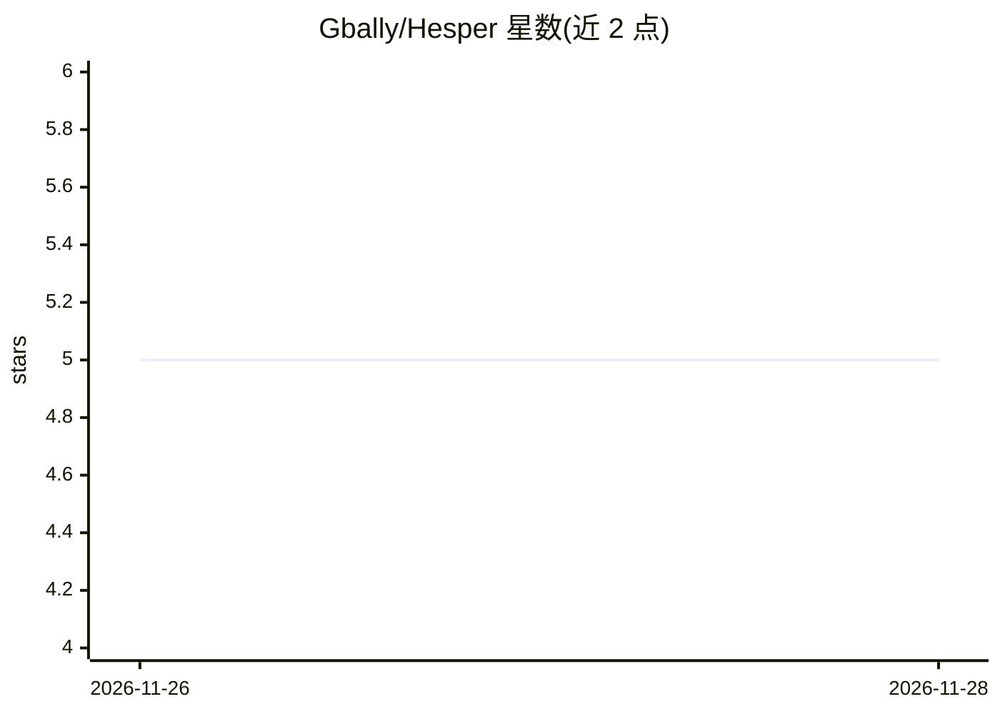

# Gbally/Hesper

⭐ 5 · Python · MIT · 推送 2026-11-27 · [GitHub](https://github.com/Gbally/Hesper) · [官网](https://gbally.github.io/Hesper/) · 组织维护

**给 Mac/Win 用户的开源离线会议纪要工具**

面向 Teams、Zoom、Meet 等通话的本地会议纪要应用：录制麦克风与会议音频两条音轨，经说话人分离生成带姓名的转写，再由本地 LLM 产出摘要、决定事项与带截止日期的待办清单，支持多语言、按会议类型模板化、以及从笔记/转写中问答并给出出处。全部识别与生成在本地运行，无账号；macOS 需 Apple silicon，Windows/Linux 可用 NVIDIA 显卡加速，提供安装包与源码构建。

## 筛选速览

| 维度 | 判定 | 备注 |
|---|---|---|
| AI 角色 | `ai-native` | 本体是模型或模型工具 |
| 许可风险 | `permissive` | MIT |
| 部署形态 | `desktop` | 安装包/桌面程序 |
| 模型依赖 | — | README 未给出锁定关系 |
| 硬件要求 | — | 无带数字的原话,不猜 |
| 安装摩擦 | `medium` | 含编译或系统依赖之一 |
| 成熟度 | `idea` | |

## 能力要点

- Whisper（MLX）转写 + sherpa-onnx 说话人分离 + Qwen3 笔记生成，全流程本地运行
- 待办与决定事项二次抽取并对照转写校验，附来源转写行回放
- 支持导入 Teams/Zoom/Otter 等 .vtt/.srt/.docx 等转写文件生成同样的笔记
- 99 种口语语言、会中自动检测语言切换，应用界面含中文

## 适用场景

- 录完 Teams/Zoom 会议后自动得到摘要、决定与待办
- 在隐私要求下不把会议音频传到云端
- 跨会议汇总分配给自己的待办并发送跟进邮件

## 场景标签

`语音识别` `文档问答` `AI 写作` · 领域:内容生成

## 证据(README 行号)

> L11: Records your Teams, Zoom or Meet calls, works out who said what, and writes a summary, the decisions
> L26: recognition (Whisper), speaker separation and the notes (Qwen) all run on your Mac's Apple silicon, or on
> L156:                        notes.md      ◄── Qwen3 (MLX): summary, decisions, to-dos

## 星数曲线

2026-11-26 5 → 2026-11-28 5（+0）

---
*卡片 v1 · prompt 1.4 · 生成 2026-11-26 · 置信度 high · 依据 README sha `597a24fded61` · [字段定义](../../DATASET.md)*
