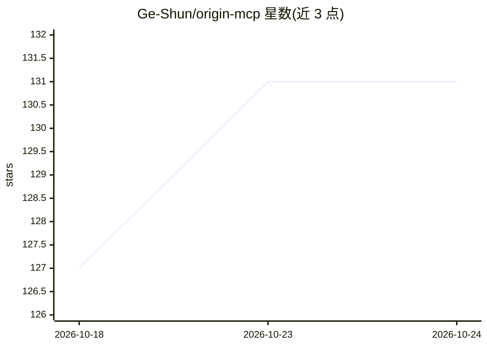

# Ge-Shun/origin-mcp

⭐ 131 · Python · MIT · 推送 2026-09-12 · [GitHub](https://github.com/Ge-Shun/origin-mcp) · 个人维护 · 中文 README

**让 AI 助手通过 MCP 操控 Origin/OriginPro 的本地服务器**

运行在 Windows 上的本地 MCP 服务器，使 AI 助手能够控制 Origin/OriginPro 完成数据与图像处理：工作表/矩阵/图像数据的导入编辑导出、2D/3D/等高线/统计图表绘制、拟合、信号处理、Peak Analyzer 与批处理流程，并可用模板与 Nature 风格预设生成出版级图形。机制上通过一个经认证的本地桥接在 Origin UI 线程内执行自动化，桥接仅监听 127.0.0.1 并使用会话令牌认证。需要正版 Origin/OriginPro（目标为 2026/2026b）与 Python 3.10+。项目声明仍在测试阶段。

## 筛选速览

| 维度 | 判定 | 备注 |
|---|---|---|
| AI 角色 | `ai-ecosystem` | LLM/agent 周边工具 |
| 许可风险 | `permissive` | MIT |
| 部署形态 | `desktop` | 安装包/桌面程序 |
| 模型依赖 | — | README 未给出锁定关系 |
| 硬件要求 | — | 无带数字的原话,不猜 |
| 安装摩擦 | `low` | 无编译、无系统依赖或容器化 |
| 成熟度 | `idea` | |

## 能力要点

- 经认证的本地桥接在 Origin UI 线程内执行自动化，仅监听 127.0.0.1
- 覆盖数据导入/变换/导出、多类图表绘制、拟合与 Peak Analyzer 等批处理工作流
- 提供 origin-mcp status / doctor 诊断命令（支持 --json）
- 可用模板、调色板与 Nature 风格预设构建出版级图形

## 适用场景

- 让 Claude 等支持 MCP 的 AI 客户端直接操作 Origin 做数据分析与绘图
- 科研数据处理中用自然语言驱动拟合、信号处理与批处理流程
- 用可复用模板生成出版级科研图表

## 场景标签

`数据分析` `科研工具` · 领域:效率与自动化

## 证据(README 行号)

> L13: `origin-mcp` is a local Model Context Protocol (MCP) server that lets AI
> L29: You need Windows, a licensed Origin/OriginPro installation, and Python 3.10+

## 星数曲线

2026-10-18 127 → 2026-10-24 131（+4）

---
*卡片 v1 · prompt 1.4 · 生成 2026-10-23 · 置信度 high · 依据 README sha `18154666fc5c` · [字段定义](../../DATASET.md)*
