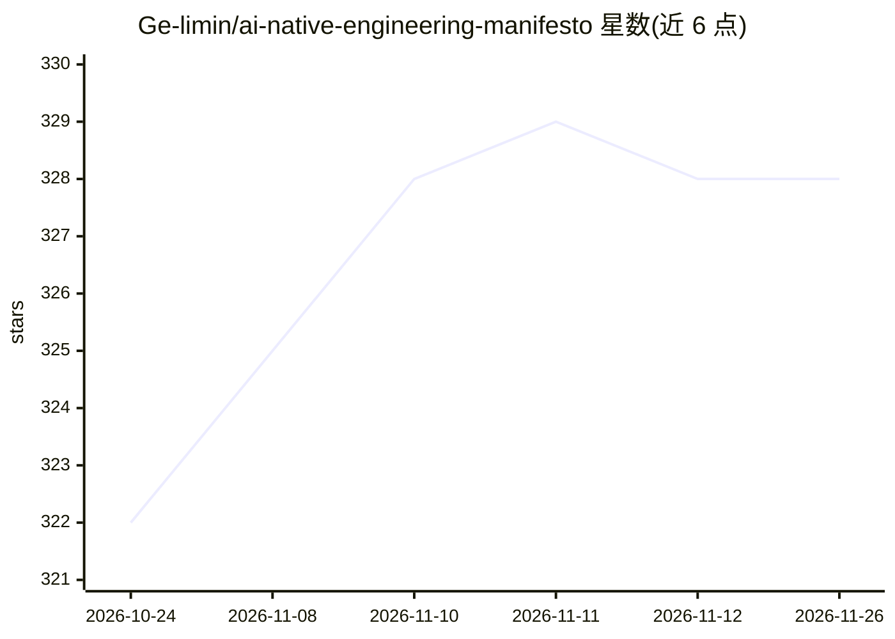

# Ge-limin/ai-native-engineering-manifesto

⭐ 328 · CC-BY-4.0 · 推送 2026-11-02 · [GitHub](https://github.com/Ge-limin/ai-native-engineering-manifesto) · [官网](https://liminge.space/manifesto) · 个人维护 · 中文 README

**面向开发者的 LLM 时代 AI-Native 软件工程宣言与实践手册**

由 Limin Ge 撰写的宣言式文档，提出 AI-Native 软件工程的 11 条"硬道理"，并以章节形式展开为 10 余篇深度文章，覆盖上下文窗口管理、测试驱动循环、文档-代码循环、SSOT 原则、AI 编码能力分级等主题。自 2025 年 3 月起多次修订，提供中英文版本与在线电子书版。定位为方法论与最佳实践集合，不包含可安装运行的软件。

## 筛选速览

| 维度 | 判定 | 备注 |
|---|---|---|
| AI 角色 | `ai-knowledge` | 知识聚合/清单类 |
| 许可风险 | `viral` | CC-BY-4.0 |
| 部署形态 | `None` |  |
| 模型依赖 | — | README 未给出锁定关系 |
| 硬件要求 | — | 无带数字的原话,不猜 |
| 安装摩擦 | `low` | 无编译、无系统依赖或容器化 |
| 成熟度 | — | 结构信号不足 |

## 能力要点

- 11 条 AI-Native 软件工程核心论断，配扩展章节逐条展开
- AI 编码用户五级能力分级模型（vibe coding 至用户故事驱动）
- Plan–Act、Test–Code、Doc–Code–Doc 三大工作循环
- 中英文双语版本与在线电子书

## 适用场景

- 为团队制定 AI 辅助开发的工作流程与规范
- 评估自身 AI 编码实践的成熟度层级
- 学习上下文工程与文档驱动的 AI 协作方法

## 场景标签

`教程课程` · 领域:学习与行业

## 证据(README 行号)

> L1: # AI-Native Engineering Manifesto (English)
> L4: > Extended deep-dive chapters live under `chapters/`, expanding several of the 11 hard truths into full articles.
> L22: ## AI-Native Engineering: 11 Hard Truths for 2025

## 星数曲线

2026-10-24 322 → 2026-11-26 328（+6）

---
*卡片 v1 · prompt 1.4 · 生成 2026-11-25 · 置信度 high · 依据 README sha `3f70584a906b` · [字段定义](../../DATASET.md)*
