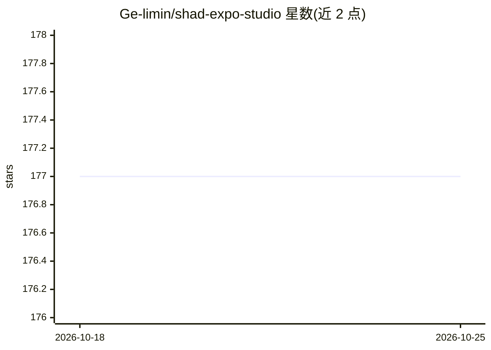

# Ge-limin/shad-expo-studio

⭐ 177 · TypeScript · MIT · 推送 2026-10-23 · [GitHub](https://github.com/Ge-limin/shad-expo-studio) · [官网](https://main--6928fcf80c2ca635d2fe1c28.chromatic.com) · 个人维护

**Expo/React Native 组件的可视化回归工作台（非组件库）**

面向 Expo / React Native 开发者的视觉回归工作流参考仓库：每个组件配有确定性示例文件，自动生成 Storybook 故事与 Chromatic 视觉基线；同一组件树在 iOS、Android、Web 三端渲染，视觉回归跑在 Web 渲染上。组件以源码形式通过 shadcn 兼容 registry 分发（npx shadcn add），用户拥有并自行修改源码。示例文件同时是编程 AI agent 可消费的机器可读用法示例，定位为 AI 辅助编码时代的 UI 回归防护。由个人维护（solo-maintained），非组件库。

## 筛选速览

| 维度 | 判定 | 备注 |
|---|---|---|
| AI 角色 | `ai-enhanced` | 去掉 AI 部分产品仍成立 |
| 许可风险 | `permissive` | MIT |
| 部署形态 | `library` | 以包/库形式分发 |
| 模型依赖 | — | README 未给出锁定关系 |
| 硬件要求 | — | 无带数字的原话,不猜 |
| 安装摩擦 | `low` | 无编译、无系统依赖或容器化 |
| 成熟度 | — | 结构信号不足 |

## 能力要点

- 每个组件的确定性示例文件自动生成 Storybook 故事与 Chromatic 基线
- 同一组件树在 iOS/Android/Web 渲染，视觉回归在 Web 端运行
- 组件以源码经 shadcn 兼容 registry 分发（npx shadcn add），复制即拥有
- CI 重建 registry 并校验与组件源码同步，PR 上跑 Chromatic diff

## 适用场景

- 我在 Expo 应用开发中为自有组件层建立可视回归基线
- 我让 AI 编程 agent 消费确定性示例文件来使用组件
- 我想把第三方组件纳入同一可视回归流程

## 场景标签

 · 领域:前端开发工具/移动端 UI 测试

## 证据(README 行号)

> L41: You're building a real Expo app, probably with AI coding agents in the loop. You own your component layer and you w
> L52: The examples files serve double duty: each `*.examples.tsx` is at once a Storybook story source and a machine-reada
> L162: Code volume exploded in the AI-assisted era and manual review misses subtle visual regressions. Deterministic stor

## 星数曲线

2026-10-18 177 → 2026-10-25 177（+0）

---
*卡片 v1 · prompt 1.4 · 生成 2026-10-22 · 置信度 mid · 依据 README sha `4158ece9f2e3` · [字段定义](../../DATASET.md)*
