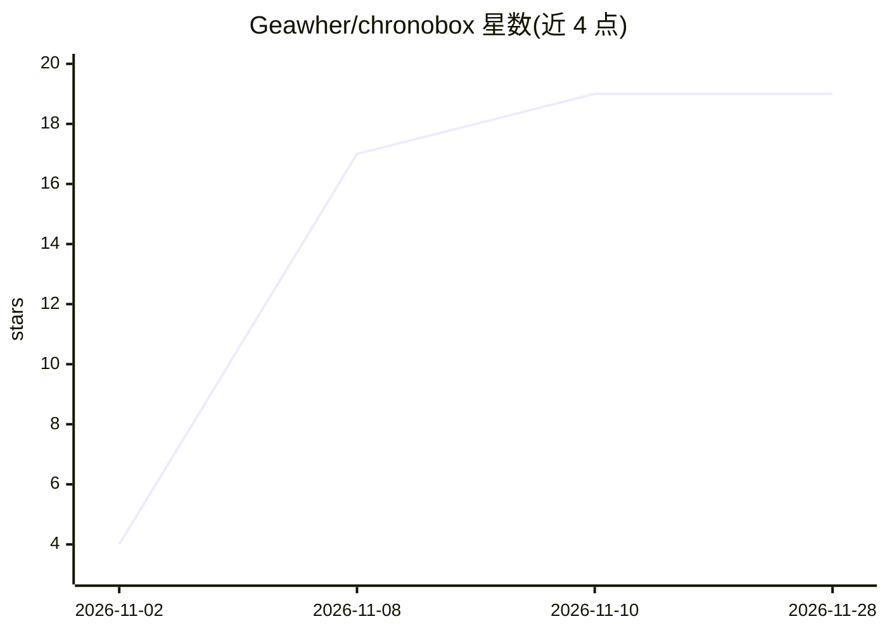

# Geawher/chronobox

⭐ 19 · Python · Apache-2.0 · 推送 2026-10-29 · [GitHub](https://github.com/Geawher/chronobox) · 个人维护

**给编码 agent 用的可精确回滚与分叉 Linux 虚拟机 MCP 服务器**

以 MCP 服务器形式向 Claude Code、Codex、Cursor 等编码 agent 提供 Firecracker microVM：支持整机（磁盘、内存、进程、数据库事务）checkpoint/回滚（约 50 ms）、fork 在线机器到精确副本上试错、rehearsal guard 拒绝未在副本验证过的破坏性命令，变更以 patch 或可重放脚本交还。面向在真实系统上执行变更的 agent 开发者。要求 x86_64 Linux + KVM + Docker + uv，不支持 macOS/Windows，microVM 无网络访问。基准显示对部分模型成功率与安全性有提升（34 任务自测）。

## 筛选速览

| 维度 | 判定 | 备注 |
|---|---|---|
| AI 角色 | `ai-ecosystem` | LLM/agent 周边工具 |
| 许可风险 | `permissive` | Apache-2.0 |
| 部署形态 | `None` |  |
| 模型依赖 | — | README 未给出锁定关系 |
| 硬件要求 | — | 无带数字的原话,不猜 |
| 安装摩擦 | `low` | 无编译、无系统依赖或容器化 |
| 成熟度 | — | 结构信号不足 |

## 能力要点

- 整机 checkpoint/回滚（磁盘/内存/进程/事务，约 50 ms）
- fork 在线机器到精确副本，试错后再应用到真实机器
- rehearsal guard：破坏性命令需先在副本成功
- Firecracker microVM 无网络隔离

## 适用场景

- 让 agent 在生产副本上演练数据库迁移等高风险变更
- agent 误操作后整机回滚
- 在自有镜像与项目上运行 agent 沙箱

## 场景标签

 · 领域:开发工具/AI agent 基础设施

## 证据(README 行号)

> L3:  A Linux machine with exact undo and forks, for coding agents, as an MCP server.
> L62: Then add it to your agent. In Claude Code, from the folder you work in:

## 星数曲线

2026-11-02 4 → 2026-11-28 19（+15）

---
*卡片 v1 · prompt 1.4 · 生成 2026-11-18 · 置信度 high · 依据 README sha `c5ba9fa70444` · [字段定义](../../DATASET.md)*
