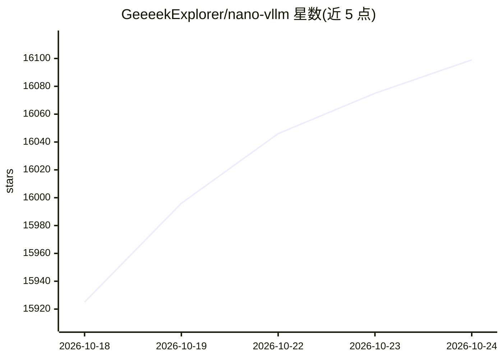

# GeeeekExplorer/nano-vllm

⭐ 16,099 · Python · MIT · 推送 2026-04-26 · [GitHub](https://github.com/GeeeekExplorer/nano-vllm) · 个人维护

**面向开发者的轻量级 LLM 离线推理引擎，从零实现 vLLM 接口**

以约 1,200 行 Python 从零实现的 vLLM 式推理引擎，提供离线批量推理，API 镜像 vLLM 接口（LLM.generate 有细微差异）。内置前缀缓存、张量并行、Torch 编译、CUDA graph 等优化项，README 附 RTX 4070 Laptop 8GB 上 Qwen3-0.6B 的吞吐对比数据。通过 pip 直接从 GitHub 安装，模型权重从 Hugging Face 下载，示例基于 Qwen/Qwen3-0.6B。

## 筛选速览

| 维度 | 判定 | 备注 |
|---|---|---|
| AI 角色 | `ai-native` | 本体是模型或模型工具 |
| 许可风险 | `permissive` | MIT |
| 部署形态 | `library` | 以包/库形式分发 |
| 模型依赖 | — | README 未给出锁定关系 |
| 硬件要求 | — | 无带数字的原话,不猜 |
| 安装摩擦 | `medium` | 含编译或系统依赖之一 |
| 成熟度 | — | 结构信号不足 |

## 动量与使用信号

- 维护:`maintenance` — 距上次 push 175.1 天,年发版 0,12 位贡献者
- 涨星:近 1 天 **+65**(自 20261016 起算)
- 安装:pypi 包 `git` 月下载无数据

## 能力要点

- 约 1,200 行 Python 代码的可读实现
- 支持前缀缓存、张量并行、Torch 编译、CUDA graph 等优化
- API 镜像 vLLM 的 LLM/SamplingParams 接口
- 提供 bench.py 基准测试脚本与吞吐数据

## 适用场景

- 在单机 GPU 上离线批量运行 Qwen 等开源模型
- 阅读源码学习 LLM 推理引擎的内部机制
- 对轻量部署场景做吞吐基准测试

## 场景标签

`推理引擎` · 领域:训练与推理

## 证据(README 行号)

> L5: A lightweight vLLM implementation built from scratch.
> L10: * 📖 **Readable codebase** - Clean implementation in ~ 1,200 lines of Python code
> L30: See `example.py` for usage. The API mirrors vLLM's interface with minor differences in the `LLM.generate` method:

## 星数曲线

2026-10-18 15,925 → 2026-10-24 16,099（+174）

---
*卡片 v1 · prompt 1.4 · 生成 2026-10-18 · 置信度 high · 依据 README sha `8e630f23484c` · [字段定义](../../DATASET.md)*
