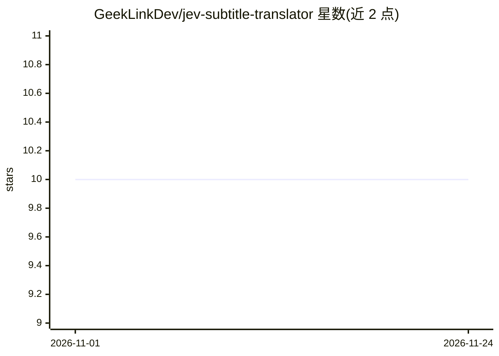

# GeekLinkDev/jev-subtitle-translator

⭐ 10 · Python · GPL-3.0 · 推送 2026-10-31 · [GitHub](https://github.com/GeekLinkDev/jev-subtitle-translator) · [官网](https://geeklink.dev/subtitle-translator/) · 组织维护

**用 LLM 翻译 SRT 字幕并自动质检标记待人工复核的行**

面向字幕翻译工作流的开源工具：解析 SRT 后按批次以 JSON Schema 结构化输出调用模型翻译，保留原始字幕序号与时间戳，缺失或空结果按字幕 ID 单独重试，未解决的行保留占位并在报告中标出。翻译后由 Jev 模型逐条审查源文与译文，标记疑似漏译、否定反转、专名/数字改动等缺陷供人工复核。提供 FastAPI 本地网页界面与 CLI 两种运行方式，QC 可关闭或换用本地模型。

## 筛选速览

| 维度 | 判定 | 备注 |
|---|---|---|
| AI 角色 | `ai-native` | 本体是模型或模型工具 |
| 许可风险 | `viral` | GPL-3.0 |
| 部署形态 | `library` | 以包/库形式分发 |
| 模型依赖 | local-ok | 支持本地模型 |
| 硬件要求 | — | 无带数字的原话,不猜 |
| 安装摩擦 | `low` | 无编译、无系统依赖或容器化 |
| 成熟度 | — | 结构信号不足 |

## 能力要点

- 字幕 ID 标签批次翻译，防止缺行，失败行保留占位并标记
- Jev 逐条质检并输出行级 JSON 报告，仅标记不改写译文
- 支持任意 OpenAI 兼容本地服务（Ollama/LM Studio/vLLM/llama.cpp）
- 本地确定性检查先行，语义 QC 可选关闭

## 适用场景

- 将已有 SRT 字幕翻译成其他语言并保留时间轴
- 对现成译文做独立质检，筛出需人工复核的行
- 把字幕翻译接入自动化流水线（CLI）
- 用本地模型离线翻译并控制 API 成本

## 场景标签

 · 领域:字幕/翻译工具

## 证据(README 行号)

> L7: An open-source SRT translator and subtitle QC tool for LLM-powered workflows. Use it to translate SRT files, preserv
> L20: - **Automatically review translations with Jev.** Jev checks every completed source–translation pair and highlights
> L59: The SRT is parsed locally, and its original subtitle numbers, order, and timestamps are kept outside the language m

## 星数曲线

2026-11-01 10 → 2026-11-24 10（+0）

---
*卡片 v1 · prompt 1.4 · 生成 2026-11-20 · 置信度 mid · 依据 README sha `98b737c5be95` · [字段定义](../../DATASET.md)*
