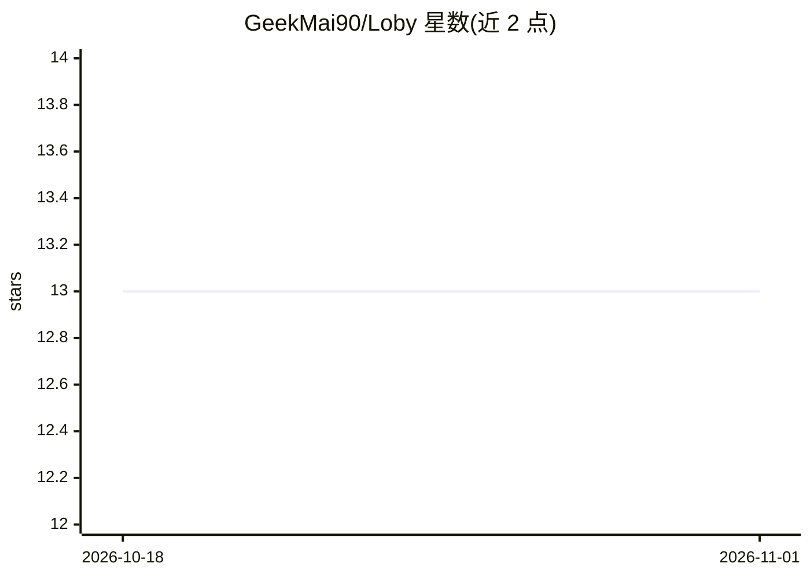

# GeekMai90/Loby

⭐ 13 · TypeScript · ISC · 推送 2026-10-31 · [GitHub](https://github.com/GeekMai90/Loby) · 个人维护 · 中文 README

**本地优先、AI 协作的 Markdown 专业写作桌面应用**

基于 Tauri 2（Rust + React + TypeScript）的桌面写作应用，以本地 Markdown 文件为唯一事实来源，用收件箱/笔记/项目组织文稿，CodeMirror 6 提供长文编辑与搜索。AI 以可审阅、可撤销的应用内协作形式提供：内置 Loby Agent Runtime 连接用户配置的模型服务，支持流式对话、工具调用、MCP 工具与联网搜索；另有可独立安装的 loby CLI，供 Codex 等外部 Agent 经用户显式授权写入文稿。支持导出与多平台发布。提供 macOS/Windows/Linux 安装包。

## 筛选速览

| 维度 | 判定 | 备注 |
|---|---|---|
| AI 角色 | `ai-enhanced` | 去掉 AI 部分产品仍成立 |
| 许可风险 | `permissive` | ISC |
| 部署形态 | `desktop` | 安装包/桌面程序 |
| 模型依赖 | — | README 未给出锁定关系 |
| 硬件要求 | — | 无带数字的原话,不猜 |
| 安装摩擦 | `low` | 无编译、无系统依赖或容器化 |
| 成熟度 | — | 结构信号不足 |

## 能力要点

- 本地 Markdown 为唯一事实来源，应用内 AI 修改可审阅、可撤销
- 内置 Loby Agent Runtime 连接用户配置的模型服务，不依赖外部 Codex runtime
- loby CLI 允许 Codex 等外部 Agent 新建或替换文稿（用户显式授权）
- Markdown/HTML 导出及 Hugo/WordPress/微信公众号等发布目标

## 适用场景

- 在本地管理并以 Markdown 写作长文与项目
- 借助 AI 协作修改文稿并保留审阅与撤销边界
- 让外部 Agent 经 CLI 授权直接写入写作库

## 场景标签

`AI 写作` · 领域:内容生成

## 证据(README 行号)

> L8: Loby 是一款本地优先、以 Markdown 为核心的专业写作桌面应用。它用可审阅、可撤销的应用内 AI 协作帮助作者写得更好，并允许用户显式授权外部 Agent 通过 CLI 新建或直接修改文稿。
> L26: - 编辑器是主界面，AI 是次级协作表面。

## 星数曲线

2026-10-18 13 → 2026-11-01 13（+0）

---
*卡片 v1 · prompt 1.4 · 生成 2026-10-31 · 置信度 high · 依据 README sha `cac56a93f42a` · [字段定义](../../DATASET.md)*
