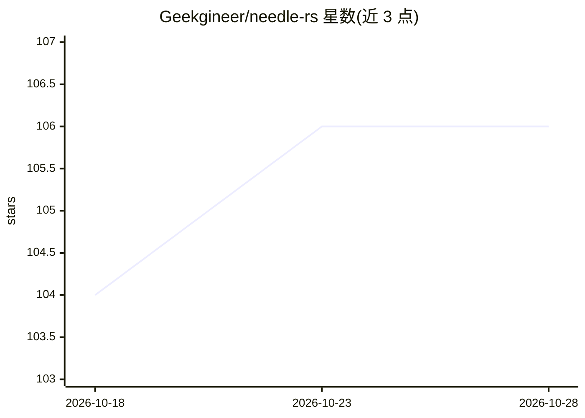

# Geekgineer/needle-rs

⭐ 106 · Rust · NOASSERTION · 推送 2026-09-19 · [GitHub](https://github.com/Geekgineer/needle-rs) · [官网](https://needle-rs.pages.dev) · 个人维护

**Needle AI 工具调用模型的纯 Rust/WASM 推理运行时**

针对 Cactus Compute Needle 函数调用模型（v1/v2/v3，26M–121M 参数）的纯 Rust + WebAssembly 推理运行时，将 (查询, 工具列表) 映射为 JSON 函数调用。同一二进制支持三代模型，可部署到浏览器、Cloudflare Workers、Node.js、Python（abi3 wheel）、C FFI 与 no_std 嵌入式目标；无需服务器与 API key。运行时 WASM 体积小于 600 KB，支持 int8 KV cache、约束解码、采样与置信度头；三引擎均通过相对 JAX 参考实现的逐 token 一致性校验。

## 筛选速览

| 维度 | 判定 | 备注 |
|---|---|---|
| AI 角色 | `ai-native` | 本体是模型或模型工具 |
| 许可风险 | `permissive` | NOASSERTION |
| 部署形态 | `library` | 以包/库形式分发 |
| 模型依赖 | — | README 未给出锁定关系 |
| 硬件要求 | — | 无带数字的原话,不猜 |
| 安装摩擦 | `low` | 无编译、无系统依赖或容器化 |
| 成熟度 | — | 结构信号不足 |

## 能力要点

- 单一二进制并行支持 Needle v1/v2/v3 三代模型
- 运行时 WASM 小于 600 KB，Needle 2 会话约 23 MB 工作内存
- 三引擎对 JAX 参考实现通过逐 token 一致性校验（v1 为 560/560 token-exact）
- 覆盖浏览器/Cloudflare Workers/Node.js/Python/C FFI/no_std 六类目标

## 适用场景

- 在浏览器标签页内离线运行函数调用，数据不离开设备
- 在边缘 Worker 或嵌入式设备上部署工具调用能力，无需后端 API
- 在 Rust/Python 项目中以库形式获得确定性的 JSON 工具调用输出

## 场景标签

`推理引擎` · 领域:训练与推理

## 证据(README 行号)

> L24: A pure-Rust + WebAssembly runtime for Needle by Cactus Compute — small transformers that map `(query, tool list)` t
> L26: **All three model generations are supported in parallel:** Needle **3** (121M, one 35.3 MB `.cact` file), Needle **

## 星数曲线

2026-10-18 104 → 2026-10-28 106（+2）

---
*卡片 v1 · prompt 1.4 · 生成 2026-10-23 · 置信度 high · 依据 README sha `c1f5df11c6a6` · [字段定义](../../DATASET.md)*
