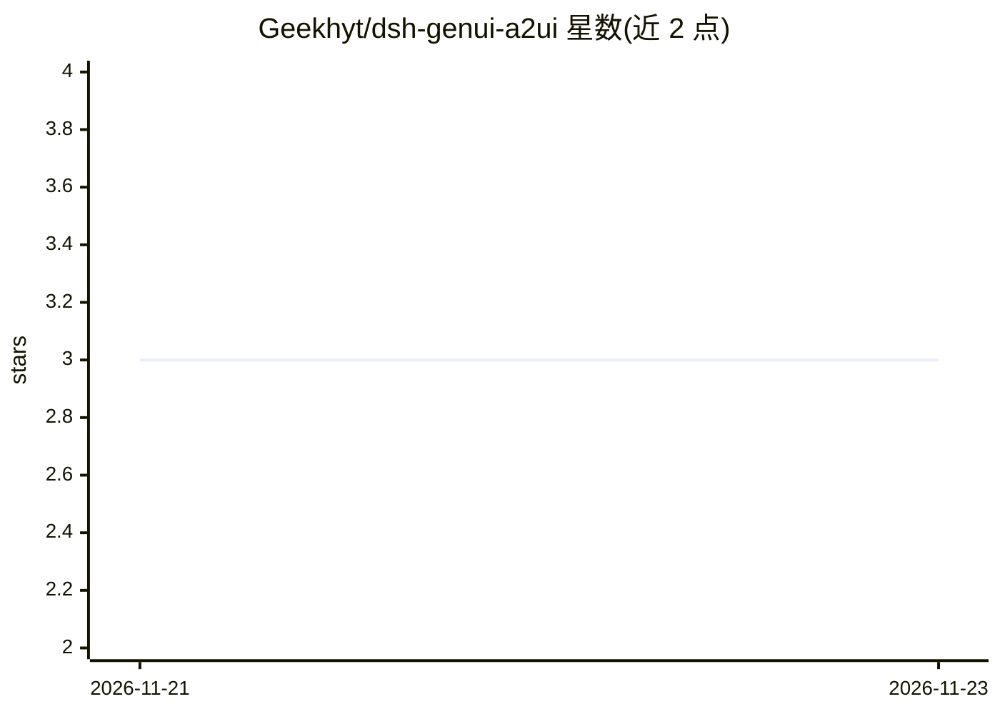

# Geekhyt/dsh-genui-a2ui

⭐ 3 · TypeScript · MIT · 推送 2026-11-22 · [GitHub](https://github.com/Geekhyt/dsh-genui-a2ui) · [官网](https://www.npmjs.com/package/dsh-genui-a2ui) · 个人维护 · 中文 README

**为 DeepSeek Harness 提供 AI 生成交互式界面回复的插件**

将 Google 开源的 A2UI（Agent to User Interface）1.0 标准接入 DeepSeek Harness 的 DSH 插件：简单问题仍以文字回复，遇到数据对比、测算推演、代码审阅等场景时，模型输出结构化 JSON 声明，由插件流式渲染为可点击、可拖动的原生交互界面。内置 57 种原生组件、19 类动态图表、服务拓扑、ProTable 与 Mermaid 架构图，支持图表与表格本地交叉筛选、导出 PNG/CSV。以 DSH 插件形式安装，也可从源码构建。

## 筛选速览

| 维度 | 判定 | 备注 |
|---|---|---|
| AI 角色 | `ai-ecosystem` | LLM/agent 周边工具 |
| 许可风险 | `permissive` | MIT |
| 部署形态 | `None` |  |
| 模型依赖 | locked-api |  |
| 硬件要求 | — | 无带数字的原话,不猜 |
| 安装摩擦 | `low` | 无编译、无系统依赖或容器化 |
| 成熟度 | — | 结构信号不足 |

## 能力要点

- 基于 Google A2UI 1.0 规范，模型只输出结构化 JSON，不注入外部 HTML
- 内置 57 种原生组件与 19 类动态图表，按 a2ui/analytics/devops/forms 四个域 Skill 按需加载
- 图表与表格本地 0 ms 双向交叉筛选，支持导出 2× PNG 与 CSV
- 支持流式渲染、深浅色主题自适应与关键操作确认卡片

## 适用场景

- 在对话中直接生成业务看板与多维图表而非纯文字描述
- AI 生成测算沙盘或选型工作台，本地拖动滑块即时重算结果
- 代码差异核对、配置变更审批等关键操作前的交互确认
- 绘制微服务拓扑、调用链瀑布与 Mermaid 架构图并联动源码

## 场景标签

`数据分析` · 领域:效率与自动化

## 证据(README 行号)

> L9: `dsh-genui-a2ui` 将 Google 开源的 A2UI（Agent to User Interface）标准带入 DeepSeek Harness。简单问题依然用文字快回；遇到数据对比、测算推演、代码审阅或复杂流程时，
> L152: - **按域按需加载 Skill，省 Token 更高准**：将 57 个组件无损拆分为 `a2ui` / `a2ui-analytics` / `a2ui-devops` / `a2ui-forms` 四个轻量域 Skill，

## 星数曲线

2026-11-21 3 → 2026-11-23 3（+0）

---
*卡片 v1 · prompt 1.4 · 生成 2026-11-22 · 置信度 high · 依据 README sha `7fffdbcfd289` · [字段定义](../../DATASET.md)*
