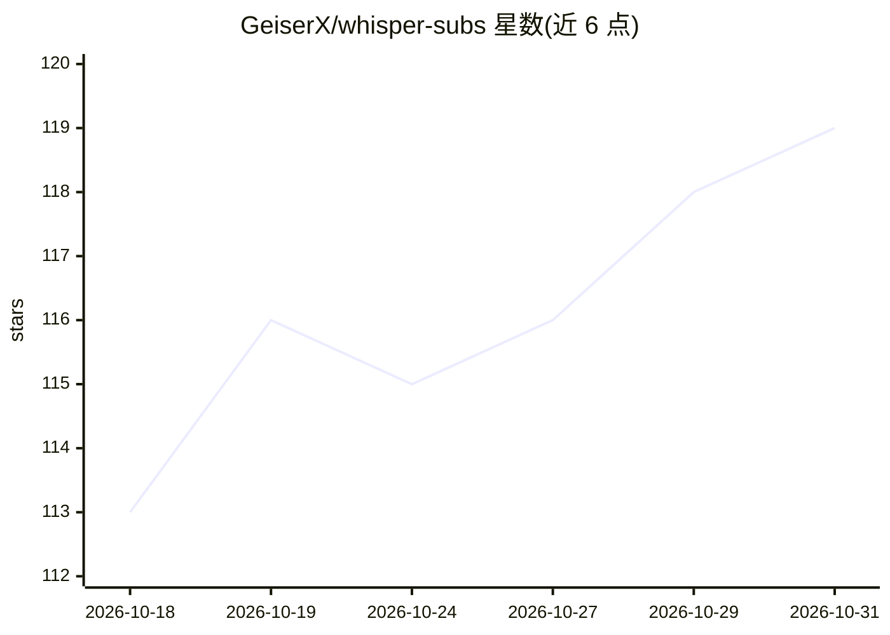

# GeiserX/whisper-subs

⭐ 119 · C# · GPL-3.0 · 推送 2026-10-29 · [GitHub](https://github.com/GeiserX/whisper-subs) · [官网](https://geiserx.github.io/whisper-subs/) · 个人维护

**Jellyfin 插件：用本地 Whisper 为媒体库生成字幕**

运行在 Jellyfin 内的字幕生成插件：对无字幕的媒体用本地 AI 模型转录音频，生成音频同语言的字幕，并可翻译为英语或 24 种欧洲语言，还支持仅覆盖外语对白的 forced 字幕与音乐库 .lrc 歌词。转录默认跑在本机或用户自加的 worker 上，支持 CUDA/Vulkan/ROCm GPU，可切换 Qwen3-ASR 1.7B（经 CrispASR，实验性）。Linux 服务器可从设置页下载引擎与模型，macOS/Windows 需自行安装 whisper-cli。兼容 Jellyfin 10.11 与 12.1，GPL-3.0-or-later。

## 筛选速览

| 维度 | 判定 | 备注 |
|---|---|---|
| AI 角色 | `ai-native` | 本体是模型或模型工具 |
| 许可风险 | `viral` | GPL-3.0 |
| 部署形态 | `self-host` | docker 或自建部署 |
| 模型依赖 | — | README 未给出锁定关系 |
| 硬件要求 | — | 无带数字的原话,不猜 |
| 安装摩擦 | `low` | 无编译、无系统依赖或容器化 |
| 成熟度 | `idea` | |

## 能力要点

- 本地 Whisper 转录生成同语言字幕并即时刷新播放器
- 翻译为英语或 24 种欧洲语言（Canary，实验性）
- 任务可分发到自有 worker 或托管后端，中断后从时间戳续跑
- 支持 CUDA/Vulkan/ROCm GPU，可换用 Qwen3-ASR 1.7B（实验性）

## 适用场景

- 为媒体库中无字幕的影片自动生成字幕
- 外语影片生成英语字幕或英语音频翻译成其他语言
- 音乐库自动生成 .lrc 歌词（实验性）

## 场景标签

`语音识别` · 领域:感知与多模态

## 证据(README 行号)

> L9: **WhisperSubs** is a Jellyfin plugin that writes subtitles for the titles in your library that have none, by transcr
> L20: - The engine and a model download from the settings page on Linux (macOS and Windows servers install `whisper-cli` 

## 星数曲线

2026-10-18 113 → 2026-10-31 119（+6）

---
*卡片 v1 · prompt 1.4 · 生成 2026-10-23 · 置信度 mid · 依据 README sha `edae88c9da9d` · [字段定义](../../DATASET.md)*
