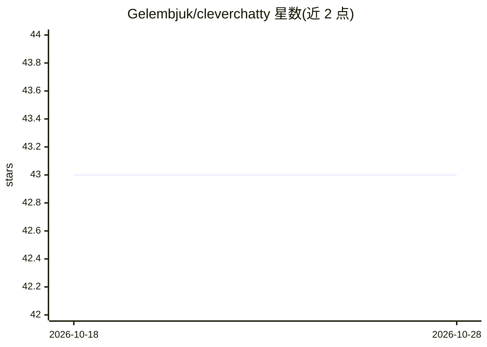

# Gelembjuk/cleverchatty

⭐ 43 · Go · MIT · 推送 2026-02-09 · [GitHub](https://github.com/Gelembjuk/cleverchatty) · 个人维护

**Go 编写的 AI 聊天/Agent 核心库，支持 MCP、RAG、A2A**

Go 包，封装 AI 聊天系统的业务逻辑，独立于具体 UI；内置 CleverChatty Server，可作为守护进程通过 A2A 协议服务多客户端，集中管理多个 AI 模型与 MCP 服务器。支持 STDIO/HTTP/SSE 三类 MCP 服务器，可作为 A2A 服务端或客户端（其他 A2A 服务器可作为工具使用），并支持 Mem0 等 AI Memory 服务与 RAG。模型接入 Ollama、Anthropic、OpenAI、Google，格式为 provider:model。首个版本由 mcphost 复制重构而来（移除 UI）。

## 筛选速览

| 维度 | 判定 | 备注 |
|---|---|---|
| AI 角色 | `ai-ecosystem` | LLM/agent 周边工具 |
| 许可风险 | `permissive` | MIT |
| 部署形态 | `library` | 以包/库形式分发 |
| 模型依赖 | local-ok | 支持本地模型 |
| 硬件要求 | — | 无带数字的原话,不猜 |
| 安装摩擦 | `low` | 无编译、无系统依赖或容器化 |
| 成熟度 | — | 结构信号不足 |

## 能力要点

- A2A 协议服务端与客户端实现，其他 A2A 服务器可作为工具
- 支持 STDIO/HTTP/SSE 全部三类 MCP 服务器
- 支持 AI Memory 服务（Mem0 等兼容 MCP/A2A 的服务）与 RAG
- 单一机器可运行多个实例，各自管理不同模型与 MCP 服务器

## 适用场景

- 为 CLI/Web/移动端自建 UI 提供 AI 聊天后端逻辑
- 部署 A2A 协议的 Agent 服务端，集中管理模型与工具
- 把 MCP 服务器与 A2A 服务器统一作为 Agent 工具使用

## 场景标签

`Agent 框架` `RAG` · 领域:Agent 开发

## 证据(README 行号)

> L3: **CleverChatty** is a Go package that implements the core functionality of an AI chat system. It encapsulates all bu
> L5: Also, this package includes the CleverChatty Server, which can be started as a daemon and service many clients with 
> L24: The CleverChatty server is a standalone service that can be run to handle requests from clients using the A2A proto

## 星数曲线

2026-10-18 43 → 2026-10-28 43（+0）

---
*卡片 v1 · prompt 1.4 · 生成 2026-10-25 · 置信度 high · 依据 README sha `d09d850e4e95` · [字段定义](../../DATASET.md)*
