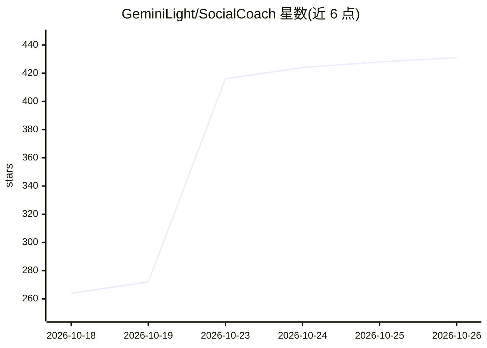

# GeminiLight/SocialCoach

⭐ 431 · TypeScript · Apache-2.0 · 推送 2026-10-23 · [GitHub](https://github.com/GeminiLight/SocialCoach) · [官网](https://tianfu.wang/SocialCoach/) · 组织维护 · 中文 README

**个人社交技能练习工具：情境对练、复盘反馈与 3D 实景演练**

面向个人的 AI 情商教练应用：用户选择或描述社交情境（如谈加薪、拒绝加班、处理家庭分歧），与有立场和底线的角色对练，复盘时教练引用用户原话给出反馈，并根据练习记录和 34 项技能熟练度推荐后续练习。提供 3D 实景（饭局、电梯口、办公室）演练，支持中英双语、无需注册、数据存浏览器可导出，可安装为 PWA。本地运行需 Node.js 22+、pnpm 11 及 Anthropic 或 OpenAI 兼容模型凭证；支持 BYOK 与 Docker Compose/Vercel/ModelScope 部署。基于 2026 年论文。声明非认证学校课程、非临床评估。

## 筛选速览

| 维度 | 判定 | 备注 |
|---|---|---|
| AI 角色 | `ai-native` | 本体是模型或模型工具 |
| 许可风险 | `permissive` | Apache-2.0 |
| 部署形态 | `self-host` | docker 或自建部署 |
| 模型依赖 | — | README 未给出锁定关系 |
| 硬件要求 | — | 无带数字的原话,不猜 |
| 安装摩擦 | `low` | 无编译、无系统依赖或容器化 |
| 成熟度 | — | 结构信号不足 |

## 能力要点

- 覆盖 7 类生活情境的 58 个场景，34 项技能熟练度估计驱动的个性化练习推荐
- 复盘引用用户原话给反馈，沟通表现与对话结果分开评估
- 3D 实景练习：饭局/电梯口/办公室，支持第一/第三人称、文字与语音
- 42 条策略与 30 个案例支持教练反馈，内容附来源；无需注册，记录存浏览器可导出

## 适用场景

- 在真实困难对话（谈加薪、拒绝加班）前先彩排一遍
- 通过复盘发现自己反复出现的沟通模式
- 在 3D 实景中练习职场饭局、电梯口等压力对话

## 场景标签

 · 领域:教育/社交情绪学习

## 证据(README 行号)

> L7: 通过真实情境对练与个性化反馈，练习社交沟通，学会处理冲突。
> L87: SocialCoach 是聚焦社交技能练习的 AI 学习工具。它参考 CASEL 的五类社交与情绪学习能力，将 34 项技能组织为自我觉察、自我管理、社会觉察、人际关系技能和负责任的决策。你可以在困难对话中反复练习，再根据自己的原
> L190: SocialCoach 基于 Wang 等人的论文 *SocialCoach: Personalized Social Skill Learning with Agentic Tutoring and Practice*（202

## 星数曲线

2026-10-18 264 → 2026-10-26 431（+167）

---
*卡片 v1 · prompt 1.4 · 生成 2026-10-23 · 置信度 mid · 依据 README sha `893d8b09fa2c` · [字段定义](../../DATASET.md)*
