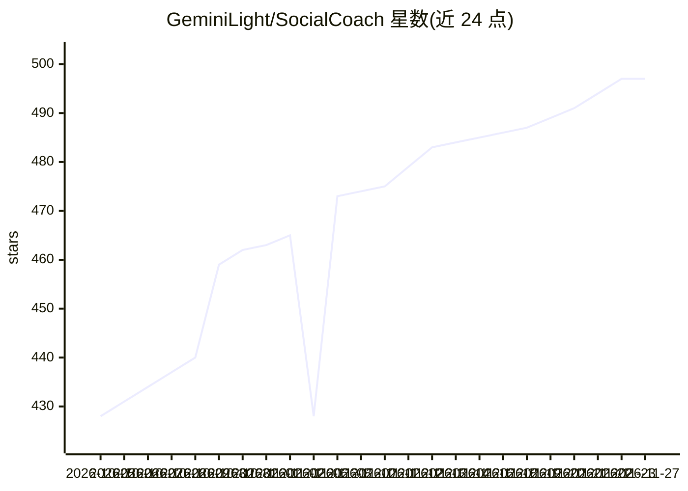

# GeminiLight/SocialCoach

⭐ 497 · TypeScript · Apache-2.0 · 推送 2026-11-09 · [GitHub](https://github.com/GeminiLight/SocialCoach) · [官网](https://tianfu.wang/SocialCoach/) · 组织维护 · 中文 README

**面向个人的 AI 情商教练：情境对练练习社交沟通**

基于 Next.js 的双语社交技能练习应用：从 7 类情境、63 个场景中选择练习，或描述自身处境生成专属练习；角色扮演中对方会追问与坚持立场，复盘引用学习者原话给出反馈。内置 34 项技能（参考 CASEL 五类 SEL）的熟练度估计与个性化排程，42 条策略与 30 个案例支持有出处的指导，另提供 3D 实景练习与 PWA 安装。支持 BYOK 自带模型、自部署与记录导出；README 声明它不是认证课程或临床评估。

## 筛选速览

| 维度 | 判定 | 备注 |
|---|---|---|
| AI 角色 | `ai-native` | 本体是模型或模型工具 |
| 许可风险 | `permissive` | Apache-2.0 |
| 部署形态 | `self-host` | docker 或自建部署 |
| 模型依赖 | — | README 未给出锁定关系 |
| 硬件要求 | — | 无带数字的原话,不猜 |
| 安装摩擦 | `low` | 无编译、无系统依赖或容器化 |
| 成熟度 | — | 结构信号不足 |

## 能力要点

- 7 类情境 63 个场景，中英双语，支持自定义处境生成练习
- 基于学习者原话的复盘反馈与 34 项技能熟练度推荐
- 42 条策略与 30 个案例附来源的指导语料
- 3D 实景场景与浏览器语音输入，可安装为 PWA

## 适用场景

- 和老板谈加薪、拒绝临时加班前先对练一遍
- 练习设立边界，如请朋友还钱、与室友商量规则
- 复盘自己的原话，识别反复出现的沟通模式

## 场景标签

`AI 助手` · 领域:对话与助手

## 证据(README 行号)

> L5: **你的专属 AI 情商教练。**
> L7: 通过真实情境对练与个性化反馈，练习社交沟通，学会处理冲突。
> L79: SocialCoach 是聚焦社交技能练习的 AI 学习工具。它参考 CASEL 的五类社交与情绪学习能力，将 34 项技能组织为自我觉察、自我管理、社会觉察、人际关系技能和负责任的决策。你可以在困难对话中反复练习，再根据自己的原

## 星数曲线

2026-10-25 428 → 2026-11-27 497（+69）

---
*卡片 v1 · prompt 1.4 · 生成 2026-11-25 · 置信度 high · 依据 README sha `9e049396bc3a` · [字段定义](../../DATASET.md)*
