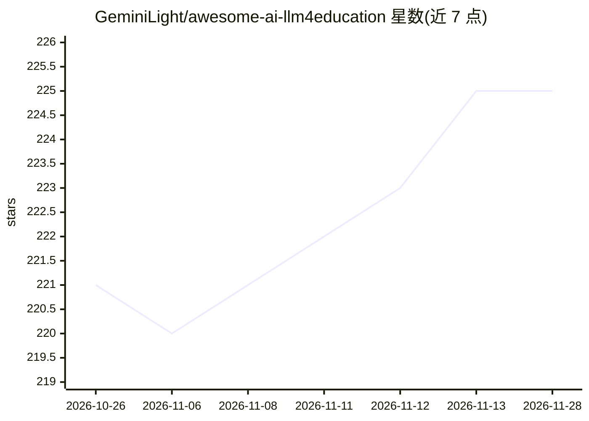

# GeminiLight/awesome-ai-llm4education

⭐ 225 · Jupyter Notebook · 推送 2026-10-23 · [GitHub](https://github.com/GeminiLight/awesome-ai-llm4education) · [官网](https://tianfu.wang/awesome-ai-llm4education/) · 组织维护

**教育领域 AI 与 LLM 论文策展清单**

收集来自顶级会议、期刊及领域会议的教育方向 AI 与 LLM 论文，按任务分类组织，分为综述与分析、教学与学习生命周期、应用领域、数据集与基准四大板块，其中生命周期部分进一步细分辅导、材料准备、学习者建模、评估等具体任务。收录 334 篇论文，时间跨度 2001–2026，其中 LLM 相关 196 篇，用 sparkles 标记。统计图表由 scripts/generate_statistics.py 从 data/papers.csv 生成，并提供在线网页版本。

## 筛选速览

| 维度 | 判定 | 备注 |
|---|---|---|
| AI 角色 | `ai-knowledge` | 知识聚合/清单类 |
| 许可风险 | `none` | — |
| 部署形态 | `None` |  |
| 模型依赖 | — | README 未给出锁定关系 |
| 硬件要求 | — | 无带数字的原话,不猜 |
| 安装摩擦 | `low` | 无编译、无系统依赖或容器化 |
| 成熟度 | — | 结构信号不足 |

## 能力要点

- 收录 334 篇论文，覆盖 51 个会议与预印本来源
- 按四大板块和三级任务层级组织目录
- 以 sparkles 标记 LLM 相关论文（196 篇）
- 统计图表由 data/papers.csv 与脚本自动生成

## 适用场景

- 查找教育 AI/LLM 方向的综述与实证论文
- 了解智能辅导、自动评分等教育任务的研究分布
- 查阅相关数据集、基准与工具包论文

## 场景标签

`精选清单` · 领域:学习与行业

## 证据(README 行号)

> L3:  A curated list of papers related to artificial intelligence (AI) and large language model (LLM) for education
> L10: The catalog is organized into **Surveys, Analyses & Perspectives**, **Teaching & Learning Lifecycle**, **Applicatio
> L46: - **Catalog coverage:** 334 papers spanning **2001–2026**.

## 星数曲线

2026-10-26 221 → 2026-11-28 225（+4）

---
*卡片 v1 · prompt 1.4 · 生成 2026-11-25 · 置信度 high · 依据 README sha `f9349c2f7441` · [字段定义](../../DATASET.md)*
