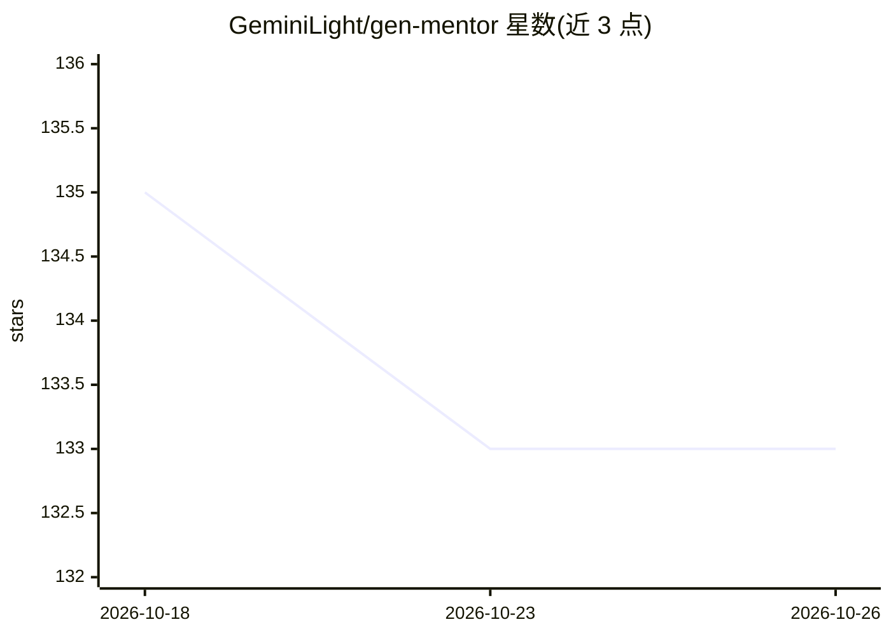

# GeminiLight/gen-mentor

⭐ 133 · TypeScript · CC0-1.0 · 推送 2026-10-23 · [GitHub](https://github.com/GeminiLight/gen-mentor) · [官网](https://genmentor.aurax.live) · 组织维护

**面向学习者的目标导向 AI 辅导系统（WWW 2025 论文官方实现）**

GenMentor 是论文 "LLM-powered Multi-agent Framework for Goal-oriented Learning in Intelligent Tutoring System"（WWW 2025 Industry Track oral）的官方实现。学习者输入目标后，九个协作 agent 依次完成目标细化、技能差距识别、学习路径排期、知识点讲义撰写、测验生成与学习者画像重建。单体 Next.js 应用，无账户与服务器数据库，学习档案存于浏览器并可导入导出 JSON；agent 调用走应用内 API 路由，支持任意 OpenAI 兼容端点或 Anthropic API，学习者也可在界面自带 API key。论文原始 Python 版本（FastAPI/Streamlit/LangChain）冻结在 v0.1-demo 分支。

## 筛选速览

| 维度 | 判定 | 备注 |
|---|---|---|
| AI 角色 | `ai-native` | 本体是模型或模型工具 |
| 许可风险 | `viral` | CC0-1.0 |
| 部署形态 | `self-host` | docker 或自建部署 |
| 模型依赖 | — | README 未给出锁定关系 |
| 硬件要求 | — | 无带数字的原话,不猜 |
| 安装摩擦 | `low` | 无编译、无系统依赖或容器化 |
| 成熟度 | — | 结构信号不足 |

## 能力要点

- 九个 agent 流水线：目标细化→技能差距→路径排期→讲义→测验→画像更新
- 支持任意 OpenAI 兼容端点或 Anthropic API，可拆分快/强双模型分工
- 无账户无服务端数据库，档案存浏览器并支持 JSON 导入导出
- 提供 Docker 构建与 Vercel 部署路径，及无 key 回放模式（录制 LLM fixtures）

## 适用场景

- 告诉系统学习目标，获得个性化的学习路径、讲义与测验
- 在无服务器 key 的公开部署下让学习者自带 API key 使用
- 复现 WWW 2025 论文的多 agent 辅导框架（v0.1-demo 分支）

## 场景标签

`多智能体` · 领域:Agent 开发

## 证据(README 行号)

> L10: GenMentor is the official implementation of *LLM-powered Multi-agent Framework for Goal-oriented
> L18: JSON file. Agent calls run inside the app's API routes against any OpenAI-compatible endpoint

## 星数曲线

2026-10-18 135 → 2026-10-26 133（-2）

---
*卡片 v1 · prompt 1.4 · 生成 2026-10-22 · 置信度 high · 依据 README sha `49c2923f9abd` · [字段定义](../../DATASET.md)*
