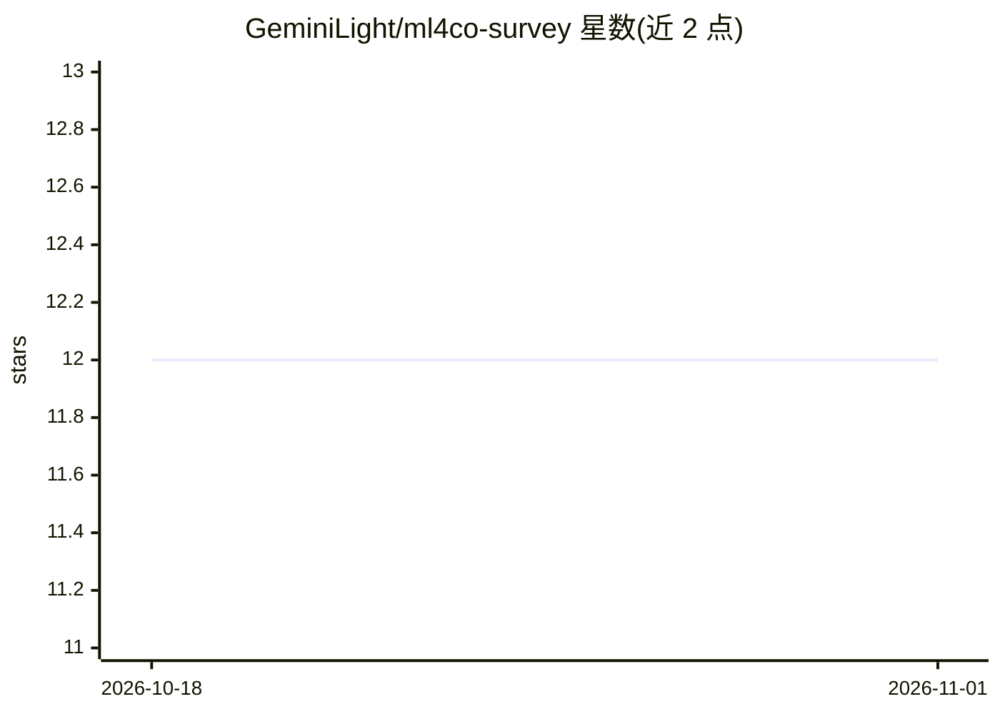

# GeminiLight/ml4co-survey

⭐ 12 · HTML · MIT · 推送 2026-10-23 · [GitHub](https://github.com/GeminiLight/ml4co-survey) · [官网](https://geminilight.github.io/ml4co-survey/) · 个人维护

**机器学习求解组合优化的论文综述清单**

由个人维护的 ML4CO（机器学习与组合优化交叉领域）文献综述仓库：从顶级会议收集相关论文，按方法类型分为监督学习、无监督学习、强化学习三类，并标注所用神经网络组件（RNN/CNN/GNN/Attention/Transformer）。覆盖 TSP、VRP、MAXCUT、SAT、MIP 等组合优化问题的条目组织，另提供 58 页幻灯片与 24 页 PDF。最后更新于 2021 年 12 月。

## 筛选速览

| 维度 | 判定 | 备注 |
|---|---|---|
| AI 角色 | `ai-knowledge` | 知识聚合/清单类 |
| 许可风险 | `permissive` | MIT |
| 部署形态 | `None` |  |
| 模型依赖 | — | README 未给出锁定关系 |
| 硬件要求 | — | 无带数字的原话,不猜 |
| 安装摩擦 | `low` | 无编译、无系统依赖或容器化 |
| 成熟度 | — | 结构信号不足 |

## 能力要点

- 从顶会收集并按方法类型分类的论文清单
- 覆盖 TSP/VRP/MAXCUT/SAT/MIP 等组合优化问题
- 附 58 页幻灯片与 24 页 PDF

## 适用场景

- 查找机器学习求解组合优化的入门文献
- 按问题类型或方法类型浏览相关论文

## 场景标签

`精选清单` · 领域:学习与行业

## 证据(README 行号)

> L8: This is a brief survey on machine learning for combinatorial optimization, a fascinating and significant topic. We m

## 星数曲线

2026-10-18 12 → 2026-11-01 12（+0）

---
*卡片 v1 · prompt 1.4 · 生成 2026-11-01 · 置信度 high · 依据 README sha `67ab64685f90` · [字段定义](../../DATASET.md)*
