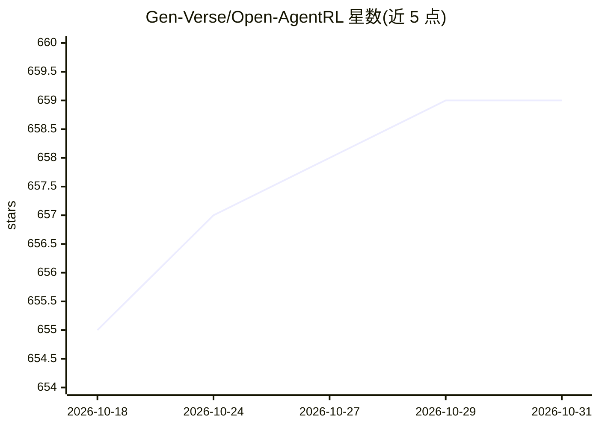

# Gen-Verse/Open-AgentRL

⭐ 659 · Python · Apache-2.0 · 推送 2026-06-12 · [GitHub](https://github.com/Gen-Verse/Open-AgentRL) · [官网](https://arxiv.org/abs/2602.02488) · 组织维护 · 中文 README

**面向 LLM 与 Agent 场景的开源强化学习训练框架与研究集合**

Gen-Verse 维护的仓库，聚合三项研究工作并开源训练代码：RLAnything（策略、奖励模型与环境闭环联合优化的动态 RL 系统）、DemyAgent（针对 agentic reasoning 的 SFT+RL 训练配方，发布 3K SFT 与 30K RL 数据集及 DemyAgent-4B 模型）、AutoTool（动态工具选择的 dual-phase 训练，含 200K 工具使用轨迹数据）。训练基于 verl、vLLM/Megatron 技术栈，支持 GUI Agent（OSWorld 虚拟机池）、文本游戏（AlfWorld）、编码 Agent 等场景；实验使用 8×Tesla-A100 节点，代码执行沙箱支持本地部署或火山引擎云服务。

## 筛选速览

| 维度 | 判定 | 备注 |
|---|---|---|
| AI 角色 | `ai-ecosystem` | LLM/agent 周边工具 |
| 许可风险 | `permissive` | Apache-2.0 |
| 部署形态 | `library` | 以包/库形式分发 |
| 模型依赖 | local-ok | 支持本地模型 |
| 硬件要求 | — | 无带数字的原话,不猜 |
| 安装摩擦 | `low` | 无编译、无系统依赖或容器化 |
| 成熟度 | — | 结构信号不足 |

## 能力要点

- RLAnything：策略/奖励模型/环境闭环联合优化的动态 RL 框架
- DemyAgent：发布 3K SFT 与 30K RL 数据集、SFT/RL 训练代码与 DemyAgent-4B 模型
- AutoTool：200K 工具选择轨迹数据集与 KL 正则 Plackett–Luce 排序的两阶段训练
- 覆盖 GUI Agent（OSWorld）、文本游戏（AlfWorld）、编码 LLM 等训练场景

## 适用场景

- 对 LLM Agent 执行 SFT 与 GRPO 强化学习训练
- 复现 ICML 2026 论文的 RLAnything/DemyAgent/AutoTool 实验
- 训练带动态工具选择能力的 agent 模型
- 使用已发布的奖励模型与数据集做下游研究

## 场景标签

`强化学习` `微调` · 领域:训练与推理

## 证据(README 行号)

> L20: In this work, we propose RLAnything, a reinforcement learning framework that dynamically optimizes each component t
> L125:  - Training code across GUI Agent, LLM Agent, and Coding LLM settings.
> L130:  - Training code for both SFT and RL stages

## 星数曲线

2026-10-18 655 → 2026-10-31 659（+4）

---
*卡片 v1 · prompt 1.4 · 生成 2026-10-21 · 置信度 high · 依据 README sha `0edcd2da7271` · [字段定义](../../DATASET.md)*
