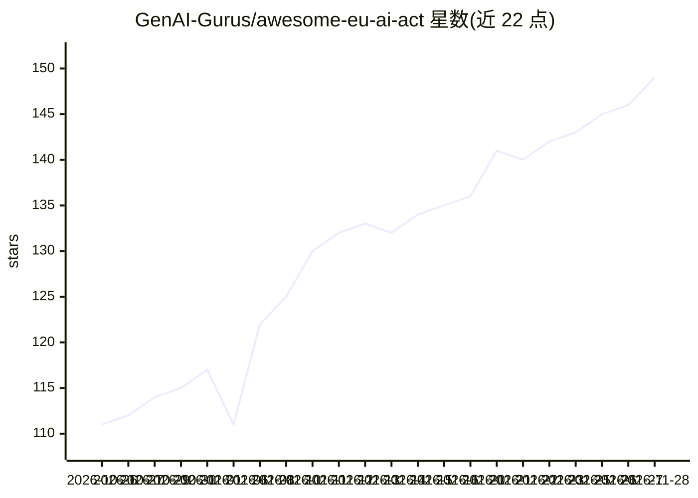

# GenAI-Gurus/awesome-eu-ai-act

⭐ 149 · CC0-1.0 · 推送 2026-11-08 · [GitHub](https://github.com/GenAI-Gurus/awesome-eu-ai-act) · [官网](https://github.com/GenAI-Gurus/awesome-eu-ai-act#readme) · 组织维护

**面向 AI Act 合规需求的官方资源与工具清单**

围绕欧盟 AI Act 合规的聚合清单：收录 EUR-Lex 法规文本、欧盟委员会与 AI Office 指南等官方来源，以及商业治理平台、AI Act 专用工具、开源合规项目（风险分级、Annex IV 文档生成、MCP 服务器）、风险评估工具与 agent 治理参考实现。面向需要理解和落地 AI Act 义务的开发者与企业合规人员，按类别组织链接并提供各条目的一句话说明。

## 筛选速览

| 维度 | 判定 | 备注 |
|---|---|---|
| AI 角色 | `ai-knowledge` | 知识聚合/清单类 |
| 许可风险 | `viral` | CC0-1.0 |
| 部署形态 | `library` | 以包/库形式分发 |
| 模型依赖 | — | README 未给出锁定关系 |
| 硬件要求 | — | 无带数字的原话,不猜 |
| 安装摩擦 | `low` | 无编译、无系统依赖或容器化 |
| 成熟度 | — | 结构信号不足 |

## 能力要点

- 官方来源：法规全文、委员会指南、GPAI Code of Practice 等链接汇总
- 收录 10+ 个开源 AI Act 合规平台与风险分级工具
- 覆盖 agent 治理工具及与 NIST AI RMF、SOC 2 等框架的映射
- 包含面向初创与中小企业的交互式指南与教育资源

## 适用场景

- 查找我的 AI 系统适用哪些 AI Act 风险等级与义务
- 为企业合规流程选型治理平台或开源工具
- 了解 GPAI 模型提供者的透明度与版权义务
- 为 AI agent 的运行时治理寻找开源方案

## 场景标签

`精选清单` · 领域:学习与行业

## 证据(README 行号)

> L1: # Awesome EU AI Act Awesome
> L5: ## Contents
> L90: ## Open-Source Projects

## 星数曲线

2026-10-26 111 → 2026-11-28 149（+38）

---
*卡片 v1 · prompt 1.4 · 生成 2026-11-28 · 置信度 mid · 依据 README sha `1e25dd611516` · [字段定义](../../DATASET.md)*
