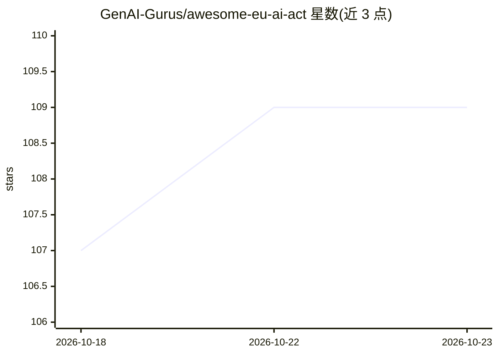

# GenAI-Gurus/awesome-eu-ai-act

⭐ 109 · CC0-1.0 · 推送 2026-10-15 · [GitHub](https://github.com/GenAI-Gurus/awesome-eu-ai-act) · [官网](https://github.com/GenAI-Gurus/awesome-eu-ai-act#readme) · 组织维护

**欧盟 AI 法案合规资源策展清单：官方文本、工具与开源项目**

面向需应对 EU AI Act 的组织与开发者，收录官方来源（EUR-Lex 法规原文、欧盟委员会指南、AI Office 平台、GPAI 行为准则）、商业合规平台（Holistic AI、Credo AI 等）、开源合规工具（风险分级器、Annex IV 文档生成、MCP 服务器）、AI agent 治理项目与律所指南，按类别组织条目并附简介。本体为 awesome 类策展清单，不提供可运行的软件本体。

## 筛选速览

| 维度 | 判定 | 备注 |
|---|---|---|
| AI 角色 | `ai-knowledge` | 知识聚合/清单类 |
| 许可风险 | `viral` | CC0-1.0 |
| 部署形态 | `library` | 以包/库形式分发 |
| 模型依赖 | — | README 未给出锁定关系 |
| 硬件要求 | — | 无带数字的原话,不猜 |
| 安装摩擦 | `low` | 无编译、无系统依赖或容器化 |
| 成熟度 | — | 结构信号不足 |

## 能力要点

- 覆盖官方法规文本、委员会指南与 GPAI Code of Practice 的官方来源汇编
- 收录 10+ 个 EU AI Act 专用开源工具（风险分级、Annex IV 生成、合规检查）
- 包含 AI agent 治理与 AGT 映射参考（OWASP Agentic Top 10、NIST AI RMF）
- 按官方来源/合规平台/开源项目/法律指南分层组织

## 适用场景

- 查找 EU AI Act 官方法规文本与实施指南
- 为组织选型 AI 治理与合规平台
- 寻找开源风险分级与 Annex IV 文档生成工具
- 了解 AI agent 治理与法规映射的参考实现

## 场景标签

`精选清单` · 领域:学习与行业

## 证据(README 行号)

> L1: # Awesome EU AI Act Awesome
> L3: > EU regulation governing the development and deployment of artificial intelligence systems, establishing a risk-bas

## 星数曲线

2026-10-18 107 → 2026-10-23 109（+2）

---
*卡片 v1 · prompt 1.4 · 生成 2026-10-23 · 置信度 mid · 依据 README sha `e8441835d79c` · [字段定义](../../DATASET.md)*
