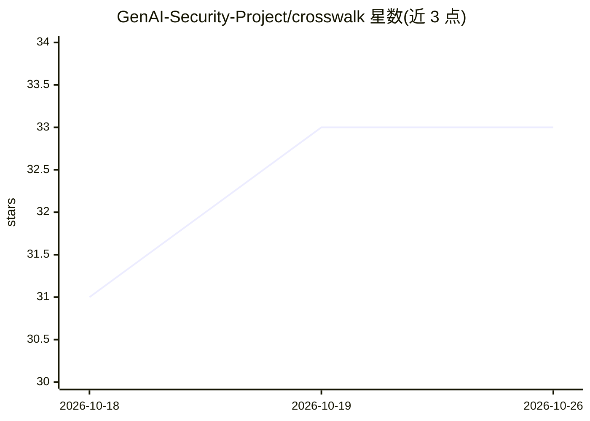

# GenAI-Security-Project/crosswalk

⭐ 33 · JavaScript · NOASSERTION · 推送 2026-10-09 · [GitHub](https://github.com/GenAI-Security-Project/crosswalk) · [官网](https://genai-security-project.github.io/crosswalk/) · 组织维护

**OWASP GenAI 安全风险到 26 个合规框架的控件映射知识库**

将 4 个 OWASP 源列表（LLM Top 10、Agentic Top 10、DSGAI 2026、Agentic Skills Top 10）的 51 条风险逐条映射到 26 个行业框架（EU AI Act、NIST、ISO、SOC 2、FedRAMP、DORA 等），生成 77 个 Markdown 映射文件。提供浏览器端 Web 应用（覆盖率评分、条目浏览、事件库）、Node.js 脚本（合规差距报告、事件分析，支持 OSCAL/STIX 导出）与 npm 包供编程查询。面向 CISO、安全工程师、红队、GRC 审计师与开发者。

## 筛选速览

| 维度 | 判定 | 备注 |
|---|---|---|
| AI 角色 | `ai-knowledge` | 知识聚合/清单类 |
| 许可风险 | `none` | NOASSERTION |
| 部署形态 | `library` | 以包/库形式分发 |
| 模型依赖 | — | README 未给出锁定关系 |
| 硬件要求 | — | 无带数字的原话,不猜 |
| 安装摩擦 | `low` | 无编译、无系统依赖或容器化 |
| 成熟度 | — | 结构信号不足 |

## 能力要点

- 51 条 OWASP GenAI 风险映射到 26 个框架的 77 个映射文件
- 浏览器端 Web 应用提供覆盖率评分与差距报告，无需安装登录
- 脚本支持 OSCAL（GRC 平台）与 STIX 2.1（SIEM/SOAR）格式导出
- 收录 147 个真实/研究事件并附 MAESTRO 层级归因

## 适用场景

- 合规官评估我在用的框架对 OWASP GenAI 风险的覆盖与缺口
- 红队按 LAAF 六阶段执行攻击并将结果映射到 OWASP 条目
- 开发者通过 npm 包编程查询风险与控件映射
- 威胁情报分析师将 147 个 AI 事件以 STIX 导入 Sentinel/Splunk

## 场景标签

`网络安全` · 领域:学习与行业

## 证据(README 行号)

> L27: > The most comprehensive publicly available mapping of OWASP GenAI security risks to industry frameworks —
> L133: Every file answers one question: **which controls from framework X address vulnerability Y?**

## 星数曲线

2026-10-18 31 → 2026-10-26 33（+2）

---
*卡片 v1 · prompt 1.4 · 生成 2026-10-25 · 置信度 mid · 依据 README sha `1b0adc543cb6` · [字段定义](../../DATASET.md)*
