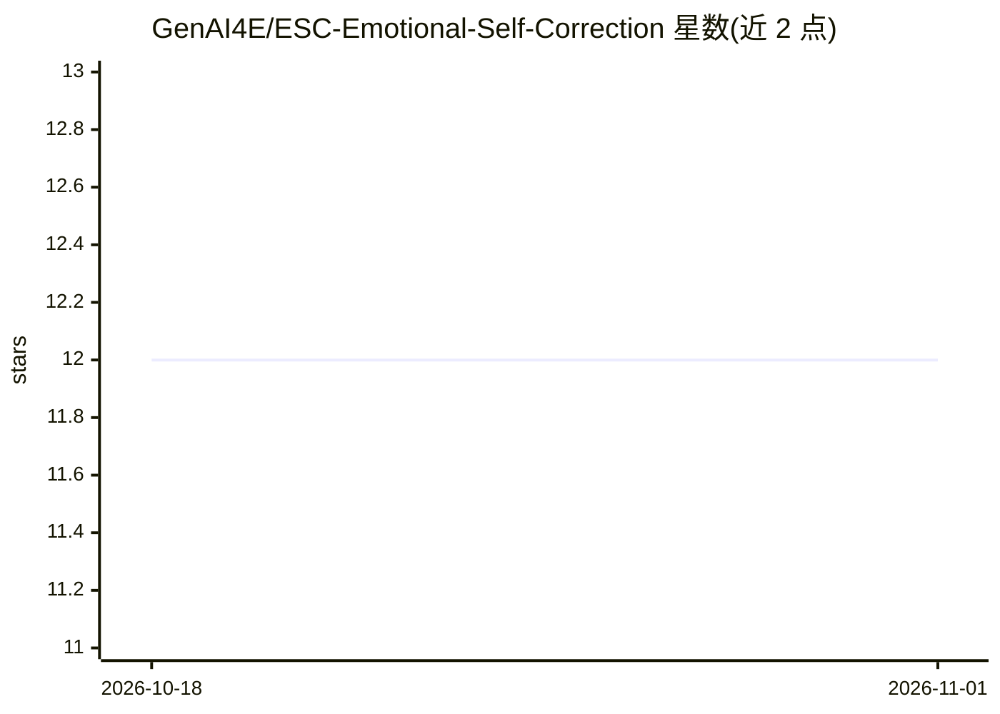

# GenAI4E/ESC-Emotional-Self-Correction

⭐ 12 · 推送 2026-07-07 · [GitHub](https://github.com/GenAI4E/ESC-Emotional-Self-Correction) · [官网](https://genai4e.github.io/ESC/?) · 组织维护

**训练无关的推理时框架：注入情绪线索让 VLM 自我纠错提升可靠性**

ECCV 2026 论文的官方代码库。ESC 是一个 training-free、即插即用的三阶段推理时循环：目标 VLM 先作答，外部验证器标记可疑回答，随后向提示注入负面低唤醒情绪线索促使模型自我纠正，全程无梯度更新。实验覆盖 LLaVA-1.5-7B 与 Qwen2-VL-7B、10 个基准；验证器默认 Gemma3-12B。提供 conda 环境与 run_esc.py 脚本，需指定 benchmark、目标模型、验证器与情绪类型等参数。

## 筛选速览

| 维度 | 判定 | 备注 |
|---|---|---|
| AI 角色 | `ai-ecosystem` | LLM/agent 周边工具 |
| 许可风险 | `none` | — |
| 部署形态 | `None` |  |
| 模型依赖 | — | README 未给出锁定关系 |
| 硬件要求 | — | 无带数字的原话,不猜 |
| 安装摩擦 | `low` | 无编译、无系统依赖或容器化 |
| 成熟度 | — | 结构信号不足 |

## 能力要点

- 三阶段推理时循环：作答→外部验证器标记→注入情绪线索自我纠正
- 无需训练、无 RL、无微调，即插即用
- 支持 10 个 benchmark（vlsafe/mmsafety/pope/hallusionbench/mmvet 等）与可配置的情绪类型/位置/数量
- 验证器可配置，默认 gemma3-12b

## 适用场景

- 降低 VLM 在安全基准上的攻击成功率并减少幻觉
- 复现论文中 LLaVA-1.5 / Qwen2-VL 的实验结果
- 在不重训模型的前提下为已有 VLM 推理流程添加自我纠错环节

## 场景标签

 · 领域:多模态模型可靠性研究

## 证据(README 行号)

> L22: **ESC** is a **training-free, plug-and-play** framework that makes VLMs more reliable — by making them a little sad
> L61: A lightweight, three-stage inference-time loop — no gradient updates.

## 星数曲线

2026-10-18 12 → 2026-11-01 12（+0）

---
*卡片 v1 · prompt 1.4 · 生成 2026-11-01 · 置信度 high · 依据 README sha `94c7d1cc7f62` · [字段定义](../../DATASET.md)*
