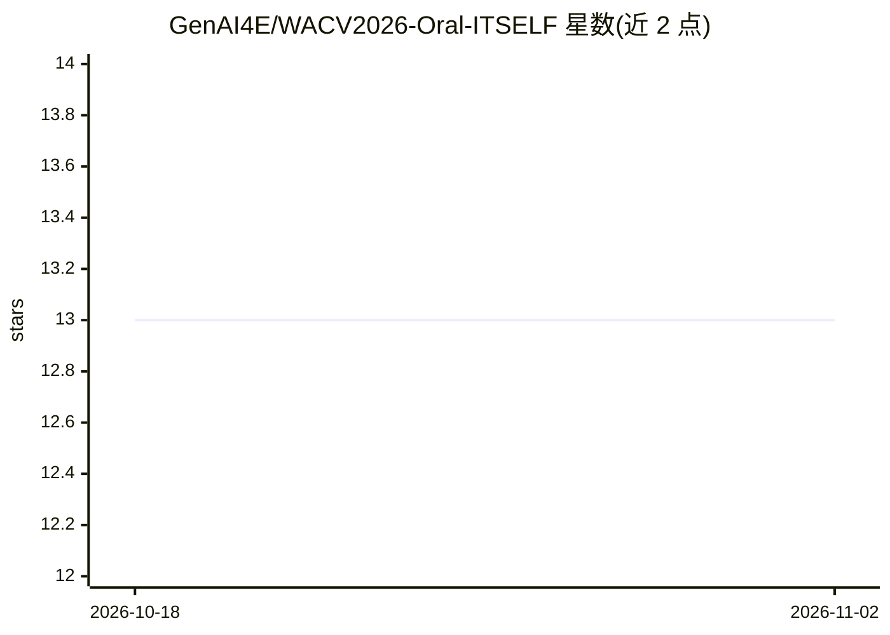

# GenAI4E/WACV2026-Oral-ITSELF

⭐ 13 · Python · MIT · 推送 2026-04-08 · [GitHub](https://github.com/GenAI4E/WACV2026-Oral-ITSELF) · [官网](https://trhuuloc.github.io/itself/) · 组织维护

**视觉-语言检索的注意力引导细粒度对齐框架（WACV 2026 论文）**

WACV 2026 Oral 论文 ITSELF 的官方代码仓库，作者来自越南国家大学胡志明市分校信息科技大学。框架利用编码器注意力挖掘细粒度判别线索，在无额外监督下强化全局文本-图像对齐；包含 MARS（跨层注意力融合与多样性感知 top-k 选择）与 ATS（保留预算退火调度）组件，在 3 个 TBPS 基准上实验。仓库提供 arXiv 论文、HuggingFace checkpoint 与项目页面链接，未包含安装运行说明，以 MIT 许可发布。

## 筛选速览

| 维度 | 判定 | 备注 |
|---|---|---|
| AI 角色 | `ai-native` | 本体是模型或模型工具 |
| 许可风险 | `permissive` | MIT |
| 部署形态 | `None` |  |
| 模型依赖 | — | README 未给出锁定关系 |
| 硬件要求 | — | 无带数字的原话,不猜 |
| 安装摩擦 | `low` | 无编译、无系统依赖或容器化 |
| 成熟度 | — | 结构信号不足 |

## 能力要点

- 注意力引导的隐式局部对齐框架（含 GRAB 模块），无需额外监督
- MARS：跨层注意力融合与多样性感知 top-k 选择
- ATS：由粗到细的保留预算退火调度
- 在 3 个 TBPS 基准上实验并报告跨数据集泛化

## 适用场景

- 文本到图像的人脸检索（TBPS）研究复现
- 视觉-语言细粒度对齐方法的参考实现
- 基于发布 checkpoint 做检索任务实验

## 场景标签

`多模态` · 领域:感知与多模态

## 证据(README 行号)

> L1: ## 📄 ITSELF: Attention Guided Fine-Grained Alignment for Vision–Language Retrieval (WACV 2026 (Oral))
> L22: - We propose ITSELF framework. A novel attention-guided implicit local alignment framework, ITSELF with GRAB that l

## 星数曲线

2026-10-18 13 → 2026-11-02 13（+0）

---
*卡片 v1 · prompt 1.4 · 生成 2026-10-31 · 置信度 mid · 依据 README sha `8c49b195ca66` · [字段定义](../../DATASET.md)*
