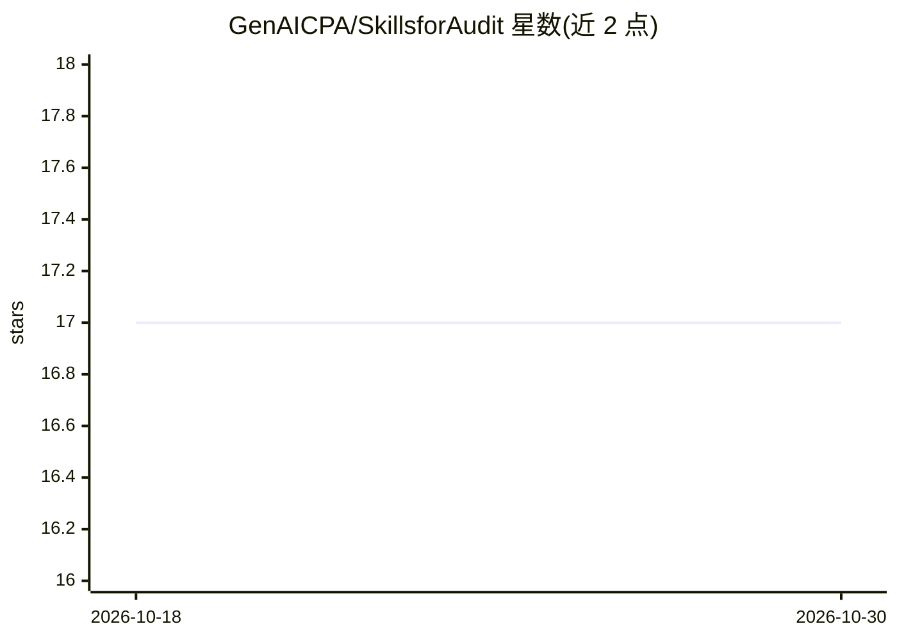

# GenAICPA/SkillsforAudit

⭐ — · [GitHub]() · 组织维护

**面向会计教育的 Claude Skills 财务审计教学课程与示例库**

由 GenAICPA 维护的教学仓库：通过 10 周渐进路径讲授如何用 Anthropic Claude Skills 构建审计助手，覆盖 Skills API 基础（PPTX/XLSX 生成）、JSON 审计清单结构化管理、Inline XBRL 财报解析校验等阶段；Phase 4-5（交叉引用引擎与整合原型）尚在规划。面向会计教授、审计监管者与从业者，明确声明仅用于教学与概念验证，不替代实际审计执业判断。示例基于 Python 3.13+ 与 anthropic SDK。

## 筛选速览

| 维度 | 判定 | 备注 |
|---|---|---|
| AI 角色 | `ai-knowledge` | 知识聚合/清单类 |
| 许可风险 | `permissive` | — |
| 部署形态 | `library` | 以包/库形式分发 |
| 模型依赖 | locked-api |  |
| 硬件要求 | — | 无带数字的原话,不猜 |
| 安装摩擦 | `low` | 无编译、无系统依赖或容器化 |
| 成熟度 | `idea` | |

## 能力要点

- 10 周分阶段学习路径（Skills 基础→结构化数据→XBRL 解析）
- 审计清单 JSON 数据模型含状态跟踪、证据引用与签核字段
- Phase 1-3 已完成，Phase 4-5（交叉引用引擎、整合原型）为规划中
- 含面向监管者的 PCoAB/AICPA 合规关注点说明

## 适用场景

- 会计/审计课程中教学 AI 辅助审计工作流
- 监管者了解 AI 审计程序的文档化与可解释性
- 从业者学习用 Claude Skills 生成审计底稿与解析 XBRL 财报

## 场景标签

`教程课程` · 领域:学习与行业

## 证据(README 行号)

> L8: A comprehensive learning path for applying Anthropic's Claude Skills to financial audit workflows, designed for acco
> L10: > **🎓 Educational Purpose**: This repository provides teaching materials and proof-of-concept demonstrations. It is
> L15: - **Learning Roadmap** - 10-week curriculum

## 星数曲线

2026-10-18 17 → 2026-10-30 17（+0）

---
*卡片 v1 · prompt 1.4 · 生成 2026-10-30 · 置信度 mid · 依据 README sha `f7021a5ac0d7` · [字段定义](../../DATASET.md)*
