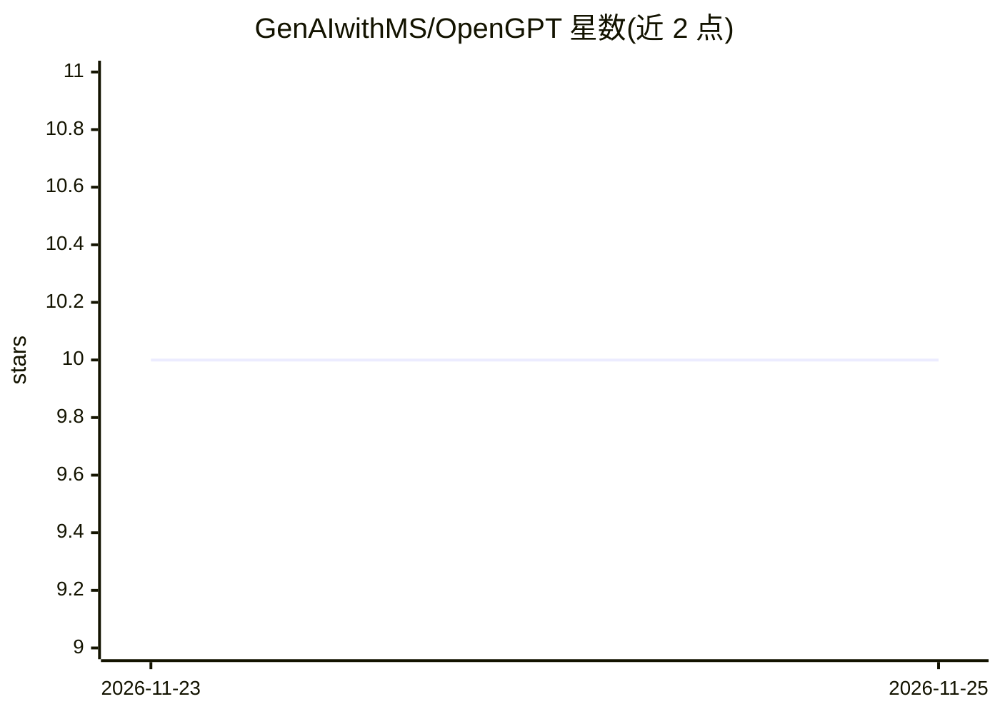

# GenAIwithMS/OpenGPT

⭐ 10 · TypeScript · MIT · 推送 2026-11-23 · [GitHub](https://github.com/GenAIwithMS/OpenGPT) · 组织维护

**开源自托管 AI 聊天工作区：多模型对话、RAG 问答与编码代理**

基于 LangGraph + FastAPI 后端与 React 前端的自托管聊天助手，支持任意 OpenAI 或 Anthropic 兼容端点（托管或本地）。功能含流式对话、工具调用（搜索/天气/股票/计算器）、多轮 Deep Research 报告、FAISS 本地嵌入的文档问答（RAG）、MySQL 持久化多线程会话、MCP 连接器、SKILL.md 技能、跨会话记忆，以及需 Bun 运行的编码代理（编辑文件/执行命令前需批准）。对话与编码代理默认仅监听本机，可配 API token 与速率限制。

## 筛选速览

| 维度 | 判定 | 备注 |
|---|---|---|
| AI 角色 | `ai-native` | 本体是模型或模型工具 |
| 许可风险 | `permissive` | MIT |
| 部署形态 | `self-host` | docker 或自建部署 |
| 模型依赖 | local-ok | 支持本地模型 |
| 硬件要求 | — | 无带数字的原话,不猜 |
| 安装摩擦 | `low` | 无编译、无系统依赖或容器化 |
| 成熟度 | — | 结构信号不足 |

## 能力要点

- 任意 OpenAI/Anthropic 兼容端点，支持本地模型（Ollama、LM Studio、llama.cpp、Jan）
- FAISS + 本地 HuggingFace 嵌入的文档 RAG 问答
- MCP 连接器与 SKILL.md 技能目录，聊天与编码代理共用工具
- 编码代理带审批机制：改文件/跑命令前显示 diff 并请求允许

## 适用场景

- 自托管一个可切换任意模型的个人 AI 聊天工作区
- 上传 PDF/Markdown 文档做检索问答
- 让编码代理在指定项目文件夹内读改代码并执行命令
- 多轮检索后生成可编辑下载的研究报告或博客文章

## 场景标签

`聊天机器人` `文档问答` `RAG` `编码 Agent` · 领域:编码与开发

## 证据(README 行号)

> L38: OpenGPT is an open-source chat assistant built with LangGraph. It has a FastAPI backend and a React frontend. It wo
> L33:  📄 Chat with documents Upload files and ask questions with FAISS-backed RAG

## 星数曲线

2026-11-23 10 → 2026-11-25 10（+0）

---
*卡片 v1 · prompt 1.4 · 生成 2026-11-23 · 置信度 mid · 依据 README sha `14ba3150c89b` · [字段定义](../../DATASET.md)*
