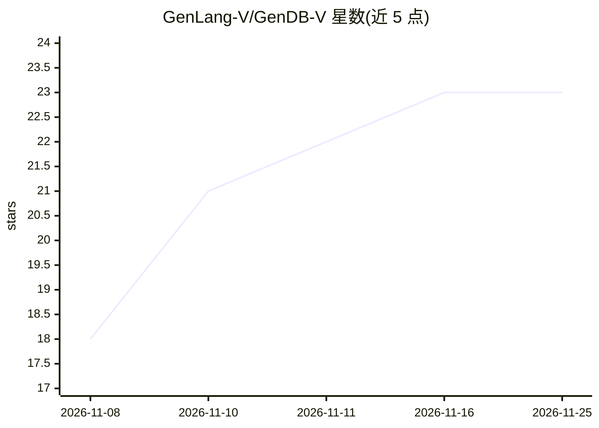

# GenLang-V/GenDB-V

⭐ 23 · Rust · NOASSERTION · 推送 2026-11-10 · [GitHub](https://github.com/GenLang-V/GenDB-V) · [官网](https://genlang-v.github.io/GenDB-V/) · 个人维护

**AI 生成并形式化验证的数据库引擎合成系统**

GenDB-V 用 AI agent（Claude Code）编写 Rust 查询引擎代码及其证明，再由 Verus 形式化验证工具对照 SQLSpec（基于 PostgreSQL 语义的 SQL 形式化规约）检查整个 crate，仅运行通过验证的代码，保证正确性、内存安全、算术安全、无数据竞争与终止性。提供引擎合成与模板合成两种模式。运行需 Linux、Rust、Python 3.12、指定版本 Verus 与 Z3，合成步骤依赖付费的 Claude Code；已发布的包可通过 gendb import 免费运行。采用 PolyForm 非商业许可，商业使用需联系作者。

## 筛选速览

| 维度 | 判定 | 备注 |
|---|---|---|
| AI 角色 | `ai-ecosystem` | LLM/agent 周边工具 |
| 许可风险 | `none` | NOASSERTION |
| 部署形态 | `None` |  |
| 模型依赖 | — | README 未给出锁定关系 |
| 硬件要求 | — | 无带数字的原话,不猜 |
| 安装摩擦 | `low` | 无编译、无系统依赖或容器化 |
| 成熟度 | — | 结构信号不足 |

## 能力要点

- AI agent 编写 Rust 引擎代码与证明，Verus 验证后才运行
- SQLSpec 形式化规约固定 SQL 语义，agent 无法更改待验证命题
- 两种模式：面向 schema 的引擎合成与面向热查询模板的模板合成
- TPC-H 相对 DuckDB 51.6×、SEC-EDGAR 61.3× 加速（自报结果）

## 适用场景

- 为特定 workload 与硬件合成经验证的查询引擎
- 查询密集场景下用验证过的模板处理热查询
- 研究形式化验证与 AI 代码生成结合的数据库构建方法

## 场景标签

`编码 Agent` · 领域:编码与开发

## 证据(README 行号)

> L34: - **An AI agent writes Rust code and its proofs.** It chooses the data layout, the algorithms and the proofs. It tr
> L35: - **Verus checks the whole crate.** It checks the code and the proofs against SQLSpec. GenDB-V runs only code that 
> L44: Tested on Linux. You need Rust, Python 3.12, the pinned Verus and Z3, and Claude Code (only to synthesize). Then ru

## 星数曲线

2026-11-08 18 → 2026-11-25 23（+5）

---
*卡片 v1 · prompt 1.4 · 生成 2026-11-18 · 置信度 high · 依据 README sha `f52b86e129ac` · [字段定义](../../DATASET.md)*
