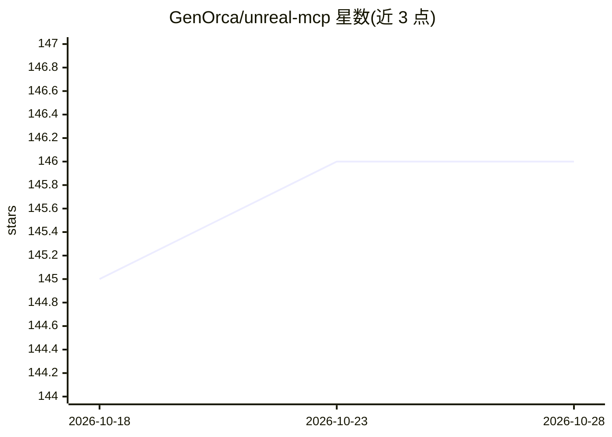

# GenOrca/unreal-mcp

⭐ 146 · Python · Apache-2.0 · 推送 2026-07-07 · [GitHub](https://github.com/GenOrca/unreal-mcp) · 个人维护

**让 AI 助手通过 MCP 直接操作虚幻编辑器的服务器**

通过 Model Context Protocol 将 Claude Desktop、VS Code、Cursor 等 MCP 客户端接入 Unreal Engine 5.6+ 编辑器，提供 253 个动作、覆盖 actor、资产、材质、蓝图、行为树、UMG、动画、Sequencer 等 21 个领域域工具，可用自然语言生成 Actor、搭建蓝图图、构建材质等。内置 execute_python 作为扩展出口，可直接运行引擎暴露的任意 BlueprintCallable 函数；扩展新动作只需添加 Python 函数并重新生成目录，无需 C++ 重编译，另有可选 C++ 辅助层。安装方式为 GitHub Releases 预编译插件包或 Fab 市场安装。

## 筛选速览

| 维度 | 判定 | 备注 |
|---|---|---|
| AI 角色 | `ai-ecosystem` | LLM/agent 周边工具 |
| 许可风险 | `permissive` | Apache-2.0 |
| 部署形态 | `desktop` | 安装包/桌面程序 |
| 模型依赖 | — | README 未给出锁定关系 |
| 硬件要求 | — | 无带数字的原话,不猜 |
| 安装摩擦 | `low` | 无编译、无系统依赖或容器化 |
| 成熟度 | — | 结构信号不足 |

## 能力要点

- 253 个动作覆盖 21 个领域（actor/资产/材质/蓝图/行为树/UMG/动画等）
- 每个领域为单一 MCP 命名空间工具，保持工具列表精简
- execute_python 可运行引擎暴露的任意 BlueprintCallable 函数
- Python 路径扩展新动作无需 C++ 与编辑器重编译

## 适用场景

- 用自然语言在虚幻编辑器中放置 Actor、生成场景
- 让 AI 助手搭建蓝图图、行为树与 UMG 界面
- AI 助手编写并执行编辑器 Python 脚本自动化美术/关卡流程
- 为自研编辑器工作流扩展自定义 MCP 动作

## 场景标签

`GUI 自动化` · 领域:效率与自动化

## 证据(README 行号)

> L5:  Connect AI assistants directly to the Unreal Editor via MCP
> L21: Unreal MCP connects AI assistants to the Unreal Editor through the Model Context Protocol. Spawn actors, build Blue
> L143: Add the server to your MCP client config:

## 星数曲线

2026-10-18 145 → 2026-10-28 146（+1）

---
*卡片 v1 · prompt 1.4 · 生成 2026-10-23 · 置信度 high · 依据 README sha `fe7fa6c9f503` · [字段定义](../../DATASET.md)*
