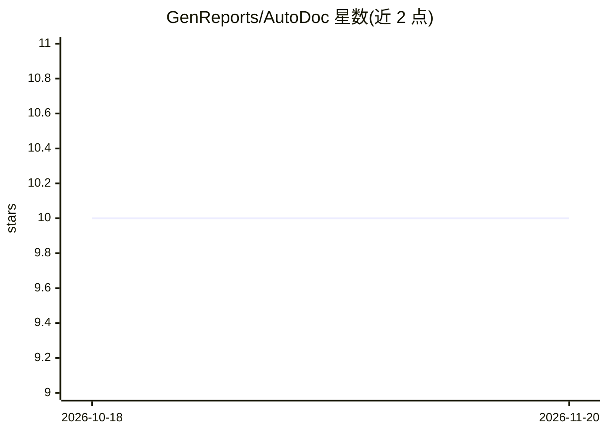

# GenReports/AutoDoc

⭐ 10 · C# · MIT · 推送 2025-12-01 · [GitHub](https://github.com/GenReports/AutoDoc) · 个人维护

**把 Git 提交历史转为 AI 日报 CSV 的桌面控制台工具**

AutoDoc 是一个多平台控制台工具，扫描 Git 仓库指定时段的提交并按天分组，将提交批量发送到 OpenAI 兼容的 /v1/chat/completions 端点做结构化摘要，失败自动重试并在请求间加入延时；用户可通过可编辑的 Context.txt 注入项目背景。输出为按 [仓库-日期-GUID] 命名的 CSV 报告。所有配置集中在 appsettings.json（仓库路径、作者邮箱、API 端点与密钥、温度、重试次数等）。使用前需自备一个可达的 AI 服务器（默认 localhost:1234），作者以 Windows x64 zip 安装包形式发布。

## 筛选速览

| 维度 | 判定 | 备注 |
|---|---|---|
| AI 角色 | `ai-native` | 本体是模型或模型工具 |
| 许可风险 | `permissive` | MIT |
| 部署形态 | `desktop` | 安装包/桌面程序 |
| 模型依赖 | — | README 未给出锁定关系 |
| 硬件要求 | — | 无带数字的原话,不猜 |
| 安装摩擦 | `low` | 无编译、无系统依赖或容器化 |
| 成熟度 | — | 结构信号不足 |

## 能力要点

- 扫描 Git 提交并按天分组，批量发送模型做结构化摘要
- 生成 [repoName]-[date]-[guidV7] 命名的 CSV 报告，含日期/步骤/活动/动机/结果等列
- 可编辑 Context.txt 向模型注入项目背景
- 请求自动重试与延时控制，配置集中于 appsettings.json

## 适用场景

- 为团队自动生成每日提交活动的结构化工作报告
- 为缺少文档的项目补齐按日的开发活动记录
- 按作者邮箱过滤并汇总特定成员的提交内容

## 场景标签

`AI 写作` · 领域:内容生成

## 证据(README 行号)

> L3: **AutoDoc** is a simple but powerful multiplatform tool that automatically analyzes Git commits and generates struct
> L4: It leverages AI to transform commit history into meaningful documentation with context-aware summaries.
> L20:  - Can use OpenAI APIs like (`/v1/chat/completions`).

## 星数曲线

2026-10-18 10 → 2026-11-20 10（+0）

---
*卡片 v1 · prompt 1.4 · 生成 2026-11-20 · 置信度 high · 依据 README sha `bb8566d54b0a` · [字段定义](../../DATASET.md)*
