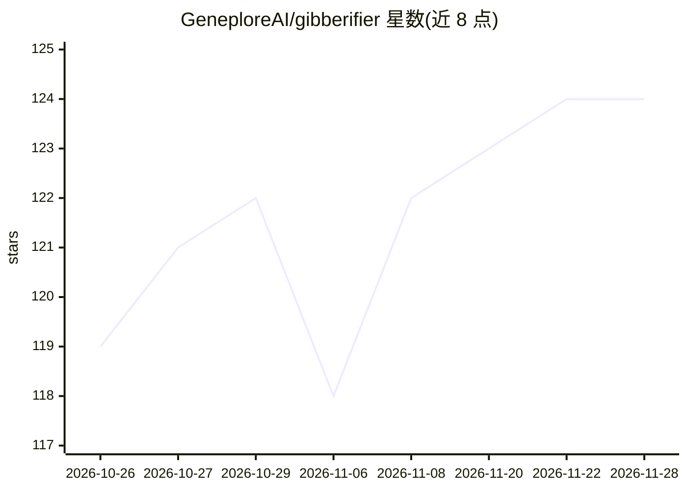

# GeneploreAI/gibberifier

⭐ 124 · HTML · GPL-3.0 · 推送 2026-11-12 · [GitHub](https://github.com/GeneploreAI/gibberifier) · [官网](https://gibberifier.com) · 个人维护

**用零宽 Unicode 字符使文本干扰 LLM 处理的工具**

一个网页工具，在输入文本的字符之间插入大量不可见零宽 Unicode 字符，文本外观不变但长度大增，使多数 LLM 聊天机器人无法正常读取；并在末尾追加 Unicode 注入以对抗具备代码分析能力的模型。建议对论文提示的关键段落（约 2500 字符内）使用。另提供 Chrome 与 Firefox 浏览器扩展，可对网页上选中文本就地处理，扩展通过 npm 构建。

## 筛选速览

| 维度 | 判定 | 备注 |
|---|---|---|
| AI 角色 | `ai-enhanced` | 去掉 AI 部分产品仍成立 |
| 许可风险 | `viral` | GPL-3.0 |
| 部署形态 | `None` |  |
| 模型依赖 | — | README 未给出锁定关系 |
| 硬件要求 | — | 无带数字的原话,不猜 |
| 安装摩擦 | `low` | 无编译、无系统依赖或容器化 |
| 成熟度 | — | 结构信号不足 |

## 能力要点

- 在字符间插入数千个零宽 Unicode 字符，文本外观不变
- 末尾追加 Unicode 注入以对抗能分析代码的模型
- 提供 Chrome 与 Firefox 扩展，网页选中文本就地处理
- 扩展通过 npm run build 构建打包

## 适用场景

- 处理作业或文章的关键段落，使 AI 检测/处理失效
- 在浏览器中对任意网页选中文本进行 gibberify

## 场景标签

 · 领域:内容防护/反 AI 处理工具

## 证据(README 行号)

> L4: **How it works:** This tool inserts thousands of invisible zero-width Unicode characters between each character of y
> L10: ## Chrome Extension:
> L11: A Chrome extension is also available that allows you to gibberify selected text directly on any webpage.

## 星数曲线

2026-10-26 119 → 2026-11-28 124（+5）

---
*卡片 v1 · prompt 1.4 · 生成 2026-11-28 · 置信度 high · 依据 README sha `cff04a63e9df` · [字段定义](../../DATASET.md)*
