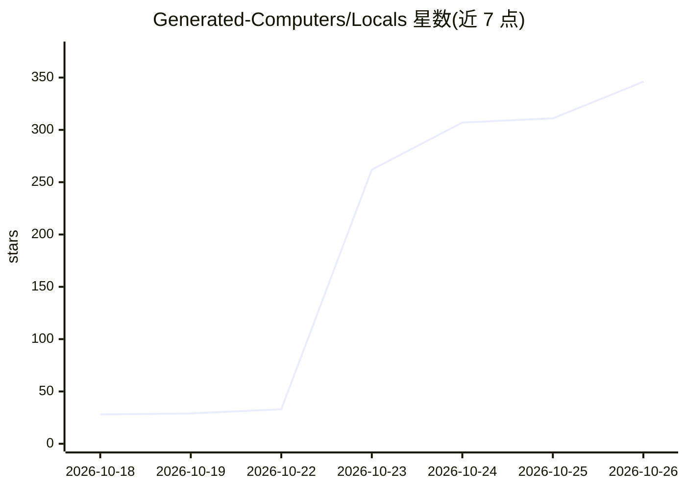

# Generated-Computers/Locals

⭐ 346 · Python · Apache-2.0 · 推送 2026-10-25 · [GitHub](https://github.com/Generated-Computers/Locals) · [官网](https://generatedcomputers.com) · 组织维护

**在 Apple Silicon Mac 上本地运行多 AI agent 的推理服务器**

面向编码 agent 而非普通聊天的本地模型服务器：以批量 GPU 内核同时计算多个 agent 的请求，在 GPU 上施加语法约束保证工具调用与 JSON 始终可解析，并将长对话与系统提示缓存到磁盘以加速后续轮次。通过 OpenAI、Anthropic 与 Ollama 兼容接口对接 OpenCode、Cline、Aider、OpenHands、Claude Code 等工具，一条命令启动并连接。要求 macOS 14 以上、Apple silicon（M1 或更新），16 GB 内存效果最佳；加速主要覆盖 4-bit 分组量化的模型格式，M5 神经加速器上的自有内核仍为实验性。基于论文 Breaking the Space Barrier 构建。

## 筛选速览

| 维度 | 判定 | 备注 |
|---|---|---|
| AI 角色 | `ai-ecosystem` | LLM/agent 周边工具 |
| 许可风险 | `permissive` | Apache-2.0 |
| 部署形态 | `library` | 以包/库形式分发 |
| 模型依赖 | local-ok | 支持本地模型 |
| 硬件要求 | — | 无带数字的原话,不猜 |
| 安装摩擦 | `low` | 无编译、无系统依赖或容器化 |
| 成熟度 | `idea` | |

## 能力要点

- 多 agent 请求批量计算，GPU 上施加语法约束使工具调用与 JSON 始终可解析
- 跨轮次与重启保留长对话与系统提示缓存（3,000-16,000 token 提示存于磁盘）
- 通过 OpenAI/Anthropic/Ollama 兼容接口连接 OpenCode、Cline、Aider、Claude Code 等编码工具
- `locals run` 可将任务拆分给多个 agent 并行处理

## 适用场景

- 在本机同时运行多个编码 agent 而不依赖云端 API
- 让现有编码工具（Cline、Aider、OpenHands 等）切换到本地模型
- 在长对话与工具调用密集的 agent 工作流中降低首 token 延迟

## 场景标签

`推理引擎` · 领域:训练与推理

## 证据(README 行号)

> L7:  A local server made for agents rather than plain chat: tool calls, long
> L45: Locals runs AI models on your own Mac for agents, not for chatting with a raw
> L54: It works with the coding agents you may already use, such as OpenCode, Cline,

## 星数曲线

2026-10-18 28 → 2026-10-26 346（+318）

---
*卡片 v1 · prompt 1.4 · 生成 2026-10-22 · 置信度 high · 依据 README sha `d53bd44910ba` · [字段定义](../../DATASET.md)*
