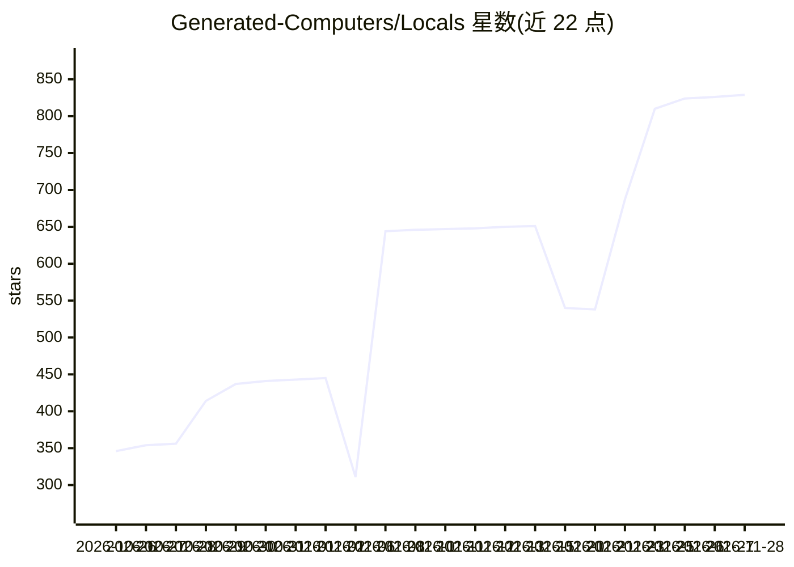

# Generated-Computers/Locals

⭐ 829 · Python · Apache-2.0 · 推送 2026-11-27 · [GitHub](https://github.com/Generated-Computers/Locals) · [官网](https://generatedcomputers.com) · 组织维护

**Mac 上为多 agent 并行设计的本地推理服务器**

面向 agent 工作负载的本地推理服务器，与普通聊天场景不同：按多请求批次设计 GPU kernel、在 GPU 上以语法约束生成工具调用、跨回合把长对话与系统提示落盘续用，并内置重复调用检测、内存守卫与挂起回收等针对 agent 的保护。兼容 OpenAI、Anthropic、Ollama 协议，可对接 OpenCode、Cline、Aider、OpenHands、Claude Code 等编码 agent。仅支持 macOS Apple silicon，通过安装脚本或 uv 从 PyPI 安装，首次运行自动下载约 3 GB 模型，数据不出本机。README 给出与 mlx-lm、llama.cpp、Ollama 的自测对比数据。

## 筛选速览

| 维度 | 判定 | 备注 |
|---|---|---|
| AI 角色 | `ai-ecosystem` | LLM/agent 周边工具 |
| 许可风险 | `permissive` | Apache-2.0 |
| 部署形态 | `library` | 以包/库形式分发 |
| 模型依赖 | local-ok | 支持本地模型 |
| 硬件要求 | — | 无带数字的原话,不猜 |
| 安装摩擦 | `low` | 无编译、无系统依赖或容器化 |
| 成熟度 | — | 结构信号不足 |

## 能力要点

- 多 agent 并发批次计算，README 称 8 并发时相对 mlx-lm 最高约 3 倍吞吐
- GPU 语法约束的工具调用生成，保证每次调用可解析并符合 schema
- 对话与长系统提示跨重启落盘，续回合只读取增量
- locals run 将任务拆分给多个并行 agent 副本，以测试结果裁决

## 适用场景

- 在 Mac 上为多个并行编码 agent 提供本地模型服务
- 通过 OpenAI/Anthropic/Ollama 兼容接口接入现有 agent 工具
- 运行长上下文工具调用任务且要求本地离线执行

## 场景标签

`推理引擎` · 领域:训练与推理

## 证据(README 行号)

> L7:  A local server made for agents rather than plain chat: tool calls, long
> L98: Locals runs AI models on your own Mac for agents, not for chatting with a raw
> L107: It works with the coding agents you may already use, such as OpenCode, Cline,

## 星数曲线

2026-10-26 346 → 2026-11-28 829（+483）

---
*卡片 v1 · prompt 1.4 · 生成 2026-11-24 · 置信度 high · 依据 README sha `e6d1e6549fbb` · [字段定义](../../DATASET.md)*
