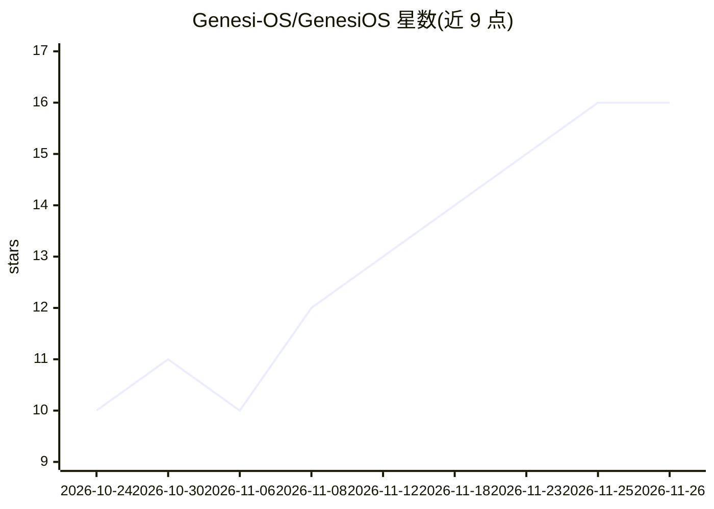

# Genesi-OS/GenesiOS

⭐ 16 · Python · AGPL-3.0 · 推送 2026-11-25 · [GitHub](https://github.com/Genesi-OS/GenesiOS) · [官网](https://www.genesios.org) · 组织维护

**面向开发者的本地 AI 调优 Linux 发行版（基于 CachyOS）**

基于 CachyOS 与 Arch 的滚动更新 Linux 发行版，安装时可选 KDE Plasma 6、Hyprland 等 9 种桌面，自带 Genesi Store、Center 等应用。其本地 AI 部分包括：genesi-aid 守护进程检测到模型运行时自动调整 CPU governor、内存、大页与 I/O，模型停止后还原；llama.cpp 的 Vulkan/CUDA 构建直接运行本地 GGUF；跨机器 GPU 显存池化的 Mesh；本地助手长期记忆 MemPalace。提供 ISO 下载安装，双通道滚动更新。

## 筛选速览

| 维度 | 判定 | 备注 |
|---|---|---|
| AI 角色 | `ai-enhanced` | 去掉 AI 部分产品仍成立 |
| 许可风险 | `viral` | AGPL-3.0 |
| 部署形态 | `None` |  |
| 模型依赖 | local-ok | 支持本地模型 |
| 硬件要求 | — | 无带数字的原话,不猜 |
| 安装摩擦 | `medium` | 含编译或系统依赖之一 |
| 成熟度 | — | 结构信号不足 |

## 能力要点

- genesi-aid 守护进程检测 Ollama/llama.cpp/vLLM/LocalAI 运行并自动调优系统参数，停止后还原
- Turbo 提供 llama.cpp 的 Vulkan 与 CUDA 构建，直接运行本地 GGUF 文件
- Mesh 在网络内多机池化 GPU 显存以运行单机装不下的模型
- 53 个自有软件包，含编辑器、git 客户端、沙箱与自动化工作流

## 适用场景

- 想要开箱即用的本地 LLM 推理调优系统
- 在多台机器上组合 GPU 显存运行大模型
- 在 Arch 系桌面上获得预配置的开发者工具链

## 场景标签

`推理引擎` · 领域:训练与推理

## 证据(README 行号)

> L12: Genesi OS is a rolling Linux distribution built on CachyOS
> L14: apps — and it treats local AI as a workload the system should tune itself for,
> L73: |**AI Mode**|A daemon (`genesi-aid`) notices when a model is running — Ollama, llama.cpp, vLLM, LocalAI — and tunes

## 星数曲线

2026-10-24 10 → 2026-11-26 16（+6）

---
*卡片 v1 · prompt 1.4 · 生成 2026-11-18 · 置信度 high · 依据 README sha `8657d14fb066` · [字段定义](../../DATASET.md)*
