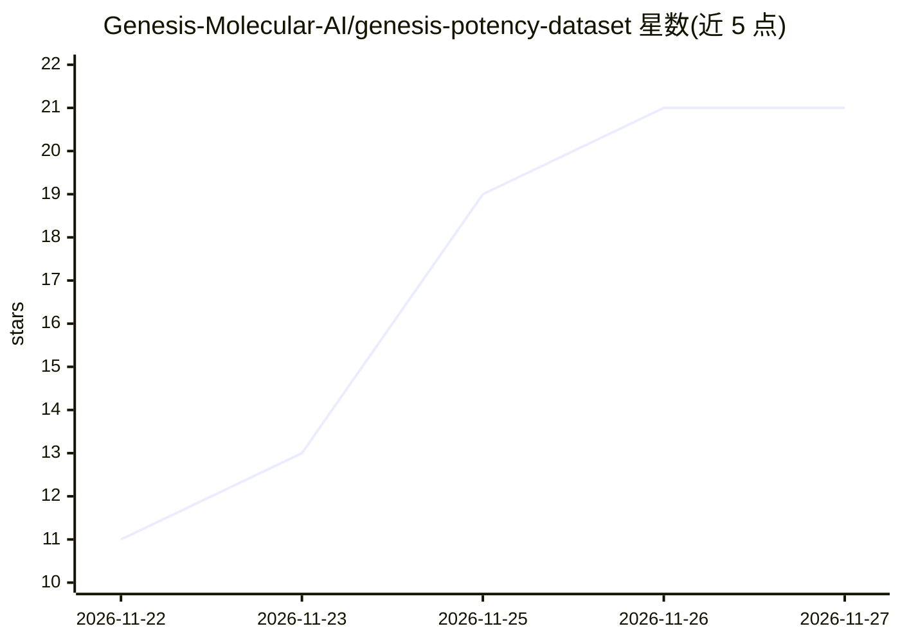

# Genesis-Molecular-AI/genesis-potency-dataset

⭐ 21 · CC-BY-SA-4.0 · 推送 2026-11-19 · [GitHub](https://github.com/Genesis-Molecular-AI/genesis-potency-dataset) · 组织维护

**面向药效预测模型的 540 万条公开蛋白-配体 potency 数据集**

GenesisPotency-2026 数据集：5,410,616 行来自 ChEMBL 37、BindingDB 与 PubChem HTS 的蛋白-配体活性数据，含 1,773,271 条 potency 测量与 3,637,345 个二分类标注，每行保留上游记录溯源（活性 ID、文档、UniProt accession）。数据托管在 Hugging Face，以单个 Parquet 文件发布并附数据字典、SHA-256 manifest 与论文公开评测集配置（ranking/hitid splits）。其中 1,451 行经 LLM agent 核对源文档后被更正并打标。全量加载约需 11 GB 内存，支持 polars 加载与 datasets 库流式读取。

## 筛选速览

| 维度 | 判定 | 备注 |
|---|---|---|
| AI 角色 | `ai-knowledge` | 知识聚合/清单类 |
| 许可风险 | `viral` | CC-BY-SA-4.0 |
| 部署形态 | `library` | 以包/库形式分发 |
| 模型依赖 | — | README 未给出锁定关系 |
| 硬件要求 | — | 无带数字的原话,不猜 |
| 安装摩擦 | `low` | 无编译、无系统依赖或容器化 |
| 成熟度 | — | 结构信号不足 |

## 能力要点

- 541 万行数据，每行链接上游 ChEMBL/BindingDB/PubChem 原始记录
- 附带 20 万条性质匹配的合成 decoy 化合物
- 1,451 行经 LLM agent 核对源文档后更正并打标
- 提供独立评测集配置（OpenFE、FEP+4、CASP16、CACHE 等基准）

## 适用场景

- 训练和评估蛋白-配体 potency 预测模型
- 药物发现中查找化合物-靶点活性测量及其原始出处
- 在公开基准上比较结合亲和力预测方法

## 场景标签

 · 领域:生命科学/计算化学数据集

## 证据(README 行号)

> L4: **5.4 million public protein–ligand potency and activity measurements, with full upstream provenance.**
> L15: - **5,410,616 rows** from ChEMBL 37, BindingDB (2026-07) and PubChem HTS bioassays.

## 星数曲线

2026-11-22 11 → 2026-11-27 21（+10）

---
*卡片 v1 · prompt 1.4 · 生成 2026-11-22 · 置信度 high · 依据 README sha `3571d92f3355` · [字段定义](../../DATASET.md)*
